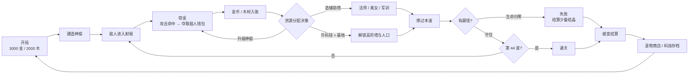
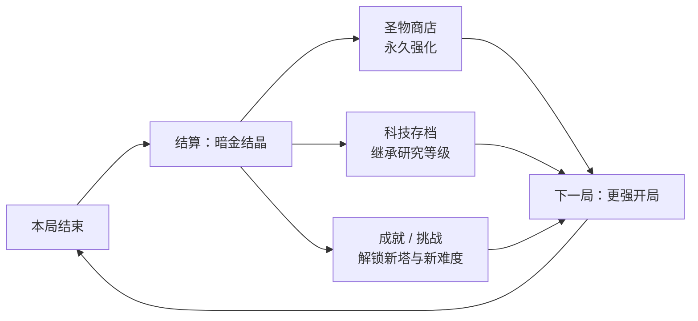
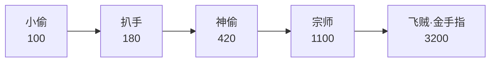
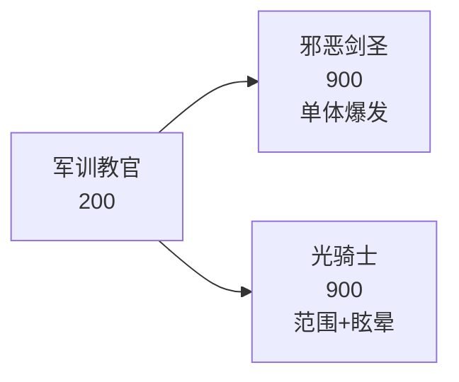
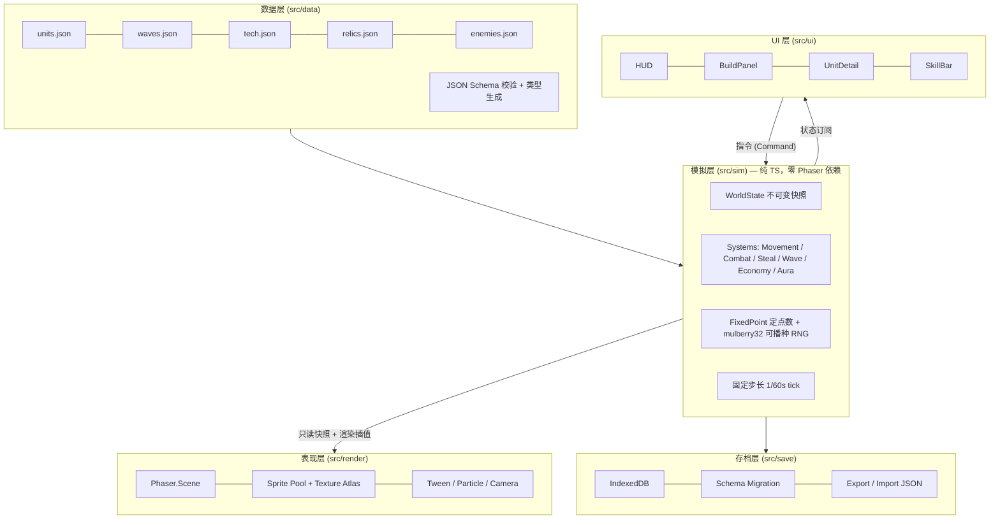

# 《窃金者 TD》开发策划案

> **网页版塔防游戏 · 参照魔兽争霸 III RPG 地图《华理小偷 TD》**
>
> 项目代号：`Goldvein` ｜ 文档版本：`v0.1` ｜ 状态：**待评审**
> 目标形态：**纯单机离线**（本地存档，无服务端） ｜ 技术栈：**TypeScript + Phaser 3 + Vite**

---

## 目录

1. [项目概述](#1-项目概述)
2. [原作机制解构](#2-原作机制解构)
3. [核心玩法设计](#3-核心玩法设计)
4. [系统设计](#4-系统设计)
5. [数值设计](#5-数值设计)
6. [UI / UX 设计](#6-ui--ux-设计)
7. [美术与音频](#7-美术与音频)
8. [技术架构](#8-技术架构)
9. [开发计划](#9-开发计划)
10. [测试与平衡验证](#10-测试与平衡验证)
11. [风险与对策](#11-风险与对策)
12. [发布与轻运营](#12-发布与轻运营)
13. [待决策事项](#13-待决策事项)
14. [附录](#14-附录)

---

## 1. 项目概述

### 1.1 一句话定位

> 一款以**「偷钱」取代「杀怪赚钱」**为核心经济引擎的网页塔防游戏：你扮演暗巷神偷团伙的幕后主使，靠**窃取**敌人随身的钱袋滚雪球式发展，用偷来的钱武装更精良的盗贼与护卫，守住宝库，撑过 44 波围剿。

### 1.2 与参考对象的关系

| 维度 | 《华理小偷 TD》原作 | 本项目 |
|---|---|---|
| 平台 | 魔兽争霸 III 自定义地图（需 War3 客户端 + 对战平台） | 浏览器（桌面 + 移动端浏览器），零安装 |
| 人数 | 1–8 人合作，4 人各守一路 | 单人，一人守 4 路（保留多路压力） |
| 核心经济 | 「小偷」攻击怪物时偷钱与木头 | **完整继承并系统化**，是全场第一设计支柱 |
| 内容承载 | 44 / 47 / 60 波，多作者改版碎片化 | 44 波基准 + 5 档难度 + 局外成长，可配置化 |
| 上手门槛 | 极高（地形卡位、黎叔归隐刷书等隐性知识，社区攻略动辄数千字） | **显性化教学**，把隐性技巧变成 UI 提示与可视化 |
| IP | 校园/网络梗命名（黎叔、校长老妈、军训），版权归属混乱 | **原创世界观与命名**，仅借鉴机制（玩法机制不受著作权保护） |

### 1.3 设计支柱（Design Pillars）

一切设计决策以这四条为准绳，违反者砍掉：

1. **窃金即输出**
   一个塔的价值 = 它偷到多少钱 × 它挡住多少怪。攻击力同时是 DPS 和经济引擎，两者不分离。这是本作区别于《绿色循环圈》《元素TD》等一切其它塔防的根本。

2. **隐性技巧显性化**
   原作高手靠口口相传的「怪会停顿的那个点」「黎叔必须每波归隐」「第一个手套最优先」——本项目把这些**做成 UI 高亮、任务引导和数值提示**。目标是让第一次玩的人在 10 分钟内摸到乐趣，而不是先看 5000 字攻略。

3. **一分钟反馈，一小时深挖**
   30 秒内看到第一笔偷金入账（即时爽感）；4 路资源分配、科技取舍、蜕变时机（长线决策）。

4. **离线可玩，进度不丢**
   纯前端、可断网、可 PWA 安装。所有成长写 IndexedDB，支持导出/导入存档。

### 1.4 目标用户

| 用户群 | 占比预估 | 需求 | 对应设计 |
|---|---|---|---|
| 怀旧党（玩过 War3 小偷系地图） | 35% | 找回偷钱手感、黎叔式养成 | 神偷系 5 级进化、点金术、停顿点卡位 |
| 现代塔防玩家（玩过《保卫萝卜》《王国保卫战》） | 40% | 易上手、有成长、画面舒服 | 显性化教学、护甲克制提示、局外圣物 |
| 数值/挂机向玩家 | 25% | 滚雪球、暴击、数字变大 | 窃金暴击、钱包指数增长、科技树 |

### 1.5 目标平台与硬性指标

| 项目 | 指标 |
|---|---|
| 浏览器 | Chrome / Edge / Firefox / Safari 最近 2 个大版本 |
| 设备 | 桌面优先，移动端浏览器可玩（触摸适配） |
| 首屏加载 | ≤ 3s @ 10Mbps；首包 ≤ 3MB，全量资源 ≤ 8MB |
| 帧率 | 60fps @ Intel i5-8250U 核显；同屏 250 敌人 + 500 投射物 |
| 内存 | ≤ 300MB |
| 单局时长 | N1 ≈ 35–45 min；N5 ≈ 60–90 min |
| 存档 | IndexedDB，自动存档（每波结束 + 每 30s），可导出 JSON |

---

## 2. 原作机制解构

本章是立项依据。以下结论来自对原作多个版本的地图说明与社区攻略的交叉比对（来源见 [附录 14.4](#144-参考资料)）。

### 2.1 原作核心机制清单

| # | 机制 | 原作表现 | 判定 |
|---|---|---|---|
| 1 | **窃金（偷钱）** | 「小偷」攻击怪物时夺取金钱；**攻击越高偷得越多**；可同时偷钱与木头 | ✅ **灵魂，必须保留并深化** |
| 2 | 双资源 | 金币（建造/升级）+ 木材（科技/解锁） | ✅ 保留 |
| 3 | 多级进化塔系 | 小偷 → 杀手 → 飞机 → 黎叔；弓箭手 → 校长老妈 | ✅ 保留，收敛为 5 级 |
| 4 | 法师六大辅助 | 心灵之火（加攻）、嗜血（加攻速）、高级减速等 | ✅ 保留，作为「辅助乘区」 |
| 5 | 护甲/攻击类型克制 | 6 类护甲 × 6 类攻击，含**神圣甲**（最后 5 波） | ⚠️ 保留但**按难度分层**，避免劝退 |
| 6 | 飞行敌人 | 「所有怪物都为飞行的」 | ✅ 保留为波次变体，不是全局 |
| 7 | 敌人反击 | 「后期的怪会攻击，英雄放前面吸引火力」 | ✅ 保留 → 转化为「肉盾/阻挡」机制 |
| 8 | 漏怪即扣命 | 有「结界守护」防漏怪 | ✅ 保留并强化视觉反馈 |
| 9 | 多路防守 | 4 人各守一路，4 菜鸟/4 老鸟 | ✅ **单机化：一人守 4 路** |
| 10 | 科技树 | 「中华科技」花费超千万；科技与数量要平衡 | ✅ 保留，分「局内 / 存档」两层 |
| 11 | 装备/商店 | 偷钱手套（倒挂金钩）大幅提升窃金 | ✅ 保留，英雄 6 格装备栏 |
| 12 | 农民/工人微操 | 工人有偷技与点金术；A 键杀自家农民 | ⚠️ 保留功能，**去掉反直觉操作** |
| 13 | 小精灵采木 | 5s/1木、5s/2木、1s/1木三档 | ✅ 保留为「木材产能」三档投资 |
| 14 | 黎叔刷书 | 黎叔 10 级归隐掉经验书，反复刷 | ❌ **删除**（伪操作量，无策略深度） |
| 15 | 存档继承 | 科技研究存档、30 层蜕变换材料、圣物商店 | ✅ 保留 → 单机版的**留存核心** |
| 16 | 挑战系统 | 飞羊、石像鬼、金币车、大魔王、装备 BOSS、团队 BOSS | ✅ 保留（团队 BOSS → 单人精英挑战） |
| 17 | 建筑师技能 | 领工资（60 倍基地产出）、荆棘丛林（硬控 3s，空中无效） | ✅ 保留，作为主动技能 |

### 2.2 必须改良的「历史包袱」

| 问题 | 原作表现 | 本项目对策 |
|---|---|---|
| **隐性知识壁垒** | 卡位点、归隐时机、手套优先级全靠口传，新手被老玩家「问候」 | ① 地面高亮「最佳窃金位」② 内置 6 步新手任务 ③ 波次预告面板显示推荐塔系 |
| **伪操作量** | 反复点黎叔归隐刷经验书 | 删除；改为「装备 + 科技」的正向成长 |
| **数值不可控** | 各改版作者随意加钱加怪，平衡崩坏（原作者公开鄙视「简单加金币的改图者」） | 全部数值进 JSON 配置表 + Schema 校验 + headless 自动跑批 |
| **多路对单人不可行** | 4 路要求 4 人 | 难度分层控制路数（N1–N2 开 2 路，N3+ 开 4 路） |
| **IP 归属混乱** | 校园梗命名、多作者互相改图 | 原创世界观与命名，规避商标与著作权风险 |
| **无进度保存** | 关掉 War3 一切归零 | IndexedDB 存档 + 圣物 + 科技继承 |

### 2.3 关键设计洞察：把「血量曲线」与「钱包曲线」解耦

原作的失衡根源是：**敌人血量**和**偷金产出**绑在同一条成长线上，作者只能整体调倍率，一调就崩。

本项目引入**「敌人钱包（Wallet）」**作为独立阀门：

- **血量 HP(n)** 决定难度曲线 —— 玩家需要多少 DPS 才能不漏怪
- **钱包 W(n)** 决定经济曲线 —— 玩家的钱从哪来
- 对**单个敌人**的总窃取量有硬上限（= 该敌人的钱包），偷光即不再产出

这一条改动带来三个结构性好处：

1. **经济曲线与难度曲线可独立调节**，平衡工作量下降一个量级。
2. **自然抑制「堆小偷」的退化策略**：堆小偷只是更快偷完同一个敌人，总收益被钱包封顶；玩家被迫思考「如何覆盖更多敌人」而非「如何堆更多小偷」——策略空间从数量转向布局。
3. **产生可量化的平衡指标**：`窃金覆盖率 = 实际窃取 / 全波敌人钱包总量`，目标区间 **65%–80%**。这个指标可以被 headless 模拟器自动测出，成为核心验收项。

---

## 3. 核心玩法设计

### 3.1 单局循环（Core Loop）



**单波节奏（约 35–50 秒）**

| 阶段 | 时长 | 玩家行为 | 系统反馈 |
|---|---|---|---|
| 备战 | 15s（可跳过/延长） | 建造、升级、分配资源 | 下一波敌人图标 + 护甲类型预告 |
| 交战 | 15–30s | 观察窃金效率、补塔、放主动技能 | 飘出 `+金币` 数字、窃金进度条（敌人钱包剩余） |
| 结算 | 3s | 决策 | 波次小结：本波窃金 / 理论钱包 / 覆盖率 / 漏怪数 |

### 3.2 局外循环（Meta Loop）



> **设计意图**：离线单机游戏没有社交留存，留存必须由**可感知的跨局变强**承担。蜕变（Ascension）是核心钩子——即使打不过，也能带着结晶离场，下一局明显更强。

### 3.3 操控与交互模型

三层操作深度，允许玩家只玩第一层也能通关 N1：

| 层级 | 操作 | 目标人群 | 是否必需 |
|---|---|---|---|
| L1 建造 | 拖放建塔、点升级、点出售 | 全部 | 必需 |
| L2 主动技能 | 建筑师技能（领工资 / 荆棘丛林）、神偷点金术 | 进阶 | 非必需 |
| L3 微操 | 英雄装备搭配、单位重新部署、路径边缘卡位 | 硬核 | 非必需 |

**核心快捷键**

| 键 | 功能 | 键 | 功能 |
|---|---|---|---|
| `1`–`9` | 选择建造项 | `空格` | 暂停 / 继续 |
| `Q W E R` | 主动技能 | `F` | 切换倍速 1x / 2x / 4x |
| `S` | 出售选中单位 | `Tab` | 循环选中同类单位 |
| `Esc` | 取消建造 | `Ctrl+Z` | 撤销上一次建造（返还 100% 金币，限 10s 内） |

> `Ctrl+Z` 撤销是网页塔防的必备品——鼠标误点导致的挫败感远高于多给一点容错。

### 3.4 胜利与失败条件

| 项 | 规则 |
|---|---|
| **生命值** | 宝库生命，按难度为 5/10/20/30/50；每漏 1 个敌人扣 1 |
| **失败** | 生命值归零；或宝库本体被拆（BOSS 可攻击宝库） |
| **胜利** | 撑过第 44 波全部敌人 |
| **提前蜕变** | 第 30 波后任意时刻可主动「蜕变」结束本局并结算（打不过时的止损出口） |
| **结算货币** | `暗金结晶 = floor(累计窃金 / 1000) × 难度系数 × 成就系数` |

---

## 4. 系统设计

### 4.1 经济系统

#### 4.1.1 三条货币来源

| 来源 | 占比目标 | 说明 |
|---|---|---|
| **窃金（主）** | 70–80% | 神偷系单位攻击命中时夺取敌人钱包 |
| 击杀奖励（辅） | 15–20% | 击杀敌人获得固定小额金币（确保纯输出塔也有回报） |
| 木材采集 | 独立资源 | 小精灵持续产木；神偷窃金时按比例附带窃木 |

#### 4.1.2 窃金公式

```
单次窃取量 = min(
    敌人剩余钱包,
    StealBase × LevelMul × (1 + 0.02 × 塔攻击力) × (1 + 窃金科技加成) × (1 + 装备加成) × CritMul
)

其中：
  StealBase        = 该塔的基础窃金系数（配置表字段）
  LevelMul         = 等级系数 = 1.0 / 1.35 / 1.85 / 2.6 / 3.8
  塔攻击力         = 当前面板攻击（含所有增益）
  窃金科技加成     = 每级 +12%，最高 5 级 = +60%
  装备加成         = 例：倒挂金钩 = +100%
  CritMul          = 暴击时 = 1.5 + 0.25 × 暴击效率等级（未暴击 = 1.0）
```

**关键约束**

- **每敌人总窃取 ≤ 该敌人钱包 W(n)**，偷光后该敌人对窃金塔不再产出金币（仍可被击杀获得击杀奖励）。
- 窃金**不依赖击杀**——敌人活着被偷光钱后仍可走完路径，此时只能靠输出塔击杀。这形成了「经济塔 vs 输出塔」的真实取舍。
- 敌人身上有可视化**钱包进度条**（金色），玩家一眼看出偷干净了没有。

#### 4.1.3 木材经济

| 单位 | 造价 | 产木 | 性价比（木/min/金） | 定位 |
|---|---|---|---|---|
| 笨拙的小精灵 | 520 金 | 5s / 1 木 | 0.0231 | 前期性价比之王 |
| 纵情的小精灵 | 1100 金 | 5s / 2 木 | 0.0218 | 中期替换 |
| 普通小精灵 | 2000 金 | 1s / 1 木 | 0.0300 | 后期资金充裕时替换 |
| 高阶小精灵 | 4500 金 | 1s / 2 木 | 0.0267 | 终局 |

> 注意：单价性价比最高的其实是「普通小精灵」，但它的**绝对造价**要求前期资金到位。这个设计与原作一致——**前期买便宜的低产能，后期换贵的**，形成一条平滑的投资曲线。

#### 4.1.4 建筑师技能

| 技能 | 冷却 | 效果 | 设计意图 |
|---|---|---|---|
| **领工资** | 90s（圣物可减至 40s） | 立即获得 `60 × 基地每秒产出` 金币 | 让「基地升级」这个看似被动的投资产生即时爽感 |
| **荆棘丛林** | 120s | 硬控所有地面敌人 3s | 紧急防漏；**对飞行无效**（保留原作设定，制造弱点认知） |

### 4.2 塔与单位体系

共 **7 大系 / 34 种单位**。所有塔统一数据结构，见 [附录 14.1](#141-配置表-ts-类型定义)。

#### 4.2.1 神偷系（核心经济塔）

| 等级 | 名称 | 造价 | 攻击 | 攻速 | 射程 | 攻击类型 | StealBase | 技能 |
|---|---|---|---|---|---|---|---|---|
| T1 | 小偷 | 100 | 8 | 1.0/s | 2.0 | 普通 | 4 | — |
| T2 | 扒手 | 180 | 16 | 1.1/s | 2.0 | 普通 | 6 | — |
| T3 | 神偷 | 420 | 34 | 1.2/s | 2.2 | 穿刺 | 10 | **潜行**：窃金效率 +25% |
| T4 | 宗师（黎叔致敬） | 1100 | 80 | 1.3/s | 2.4 | 穿刺 | 18 | **点金术**：每 20s 秒杀血量 <15% 的敌人并全额夺取其剩余钱包 |
| T5 | 飞贼·金手指 | 3200 | 200 | 1.5/s | 3.0 | 混乱 | 40 | **瞬移**：可免费重新部署；窃金无视护甲克制 |



> **T4「宗师」是对原作「黎叔」的机制致敬**（原作中黎叔需 10 级归隐），但去掉了刷书循环，改为「点金术」这个有决策感的主动效果。

#### 4.2.2 弓箭系（廉价输出 / 多目标）

| 等级 | 名称 | 造价 | 攻击 | 攻速 | 射程 | 攻击类型 | 技能 |
|---|---|---|---|---|---|---|---|
| T1 | 弓手 | 120 | 12 | 0.9/s | 5.5 | 穿刺 | — |
| T2 | 多重弓手 | 260 | 20 | 1.0/s | 6.0 | 穿刺 | 多重箭 ×2 目标 |
| T3 | 弓手老妈 | 600 | 38 | 1.1/s | 6.5 | 穿刺 | 多重箭 ×3 目标 |
| T4 | 校长老妈（致敬） | 1500 | 70 | 1.2/s | 7.0 | 穿刺 | 多重箭 ×4 目标 + 弹射 1 次 |

> **平衡注记**：原作明确说「弓手将是最垃圾的塔」，但前期又必须靠弓守。本项目把这个「前期强、后期弱」定位保留为**明确的设计意图**，并在 UI 上标注「过渡塔」，避免玩家误投资源。

#### 4.2.3 法师系（辅助乘区）

| 等级 | 名称 | 造价 | 攻击 | 攻速 | 射程 | 攻击类型 | 光环效果（不可叠加，取最高） |
|---|---|---|---|---|---|---|---|
| T1 | 法师 | 150 | 10 | 0.8/s | 4.5 | 魔法 | — |
| T2 | 萨满 | 350 | 18 | 0.9/s | 5.0 | 魔法 | **心灵之火**：半径 4 内友方塔 +25% 攻击 |
| T3 | 守望者 | 700 | 30 | 1.0/s | 5.0 | 魔法 | **嗜血**：半径 4 内友方塔 +30% 攻速 |
| T4 | 法师老爸 | 1400 | 55 | 1.0/s | 5.5 | 魔法 | **高级减速**：半径 5 内敌人 −40% 移速 |
| T5 | 法师爷爷 | 3000 | 100 | 1.1/s | 6.0 | 魔法 | **大法师光环**：全图 +15% 攻击 / +15% 攻速 / +10% 射程 |

#### 4.2.4 军训系（阻挡与爆发）

| 等级 | 名称 | 造价 | 攻击 | 攻速 | 射程 | 攻击类型 | 技能 |
|---|---|---|---|---|---|---|---|
| T1 | 军训教官 | 200 | 22 | 1.0/s | 1.8 | 普通 | **阻挡 2** 个地面敌人 |
| T2-A | 邪恶剑圣 | 900 | 110 | 1.6/s | 2.0 | 普通 | 单体爆发；**斩击**：对血量 >70% 的敌人 ×1.5 伤害 |
| T2-B | 光骑士 | 900 | 55 | 1.2/s | 2.0 | 魔法 | 范围伤害；**眩晕**：30% 概率眩晕 1s |



> 二选一分支，**不可回退**（除非出售重建）。这是「肉盾」定位的实现——把敌人的火力从脆皮塔身上吸走，对应原作「英雄放前面吸引火力」。

#### 4.2.5 美女系（减速与群伤）

| 等级 | 名称 | 造价 | 攻击 | 攻速 | 射程 | 攻击类型 | 技能 |
|---|---|---|---|---|---|---|---|
| T1 | 冰封美女 | 220 | 14 | 0.9/s | 4.0 | 魔法 | 命中减速 25%，持续 2s |
| T2 | 美人鱼 | 800 | 45 | 1.0/s | 4.5 | 魔法 | 群体减速 35% + 溅射 1.2 |
| T3 | 美人鱼老妈 | 2200 | 90 | 1.1/s | 5.0 | 魔法 | 群体减速 50% + 范围冰冻 1.5s |

#### 4.2.6 炮塔系（对城甲与群体）

| 等级 | 名称 | 造价 | 攻击 | 攻速 | 射程 | 攻击类型 | 技能 |
|---|---|---|---|---|---|---|---|
| T1 | 炮塔 | 250 | 40 | 0.6/s | 5.0 | 攻城 | 溅射半径 1.2 |
| T2 | 榴弹炮 | 900 | 95 | 0.7/s | 6.0 | 攻城 | 溅射半径 1.8 |
| T3 | 地狱火 | 2600 | 200 | 0.8/s | 7.0 | 攻城 | 溅射半径 2.5 + 灼烧 5s |

> 原作反复强调「一定要多出炮塔，不要舍不得钱」，其原因是**城甲敌人只有攻城攻击能高效处理**。本项目保留这个知识，但通过波次预告面板直接告诉玩家。

#### 4.2.7 英雄系（后期核心 + 装备载体）

| 项 | 规则 |
|---|---|
| 数量 | 最多 **2 个**（与原作一致，原作明确说「强烈建议出 2 个相同的，不然你绝对不够钱用」） |
| 造价 | 第一个 5000 金 / 500 木；第二个 12000 金 / 1200 木 |
| 特性 | 攻击类型「混乱」，无视护甲克制（对神圣甲有效），可移动、可重新部署 |
| 装备栏 | 6 格 |
| 变身 | 10 级（+50% 攻击）、20 级（+100%，解锁第二技能）、30 级（终极形态，外观与特效变化） |
| 经验来源 | 击杀 + 窃金（窃金也涨经验，强化「偷」的主线） |

**专属装备（商店）**

| 装备 | 价格 | 效果 |
|---|---|---|
| **倒挂金钩** | 3000 金 | 窃金效率 +100%（原作明确提到此装备让偷钱速度大增 N 倍） |
| 点金手套 | 2500 金 | 窃金暴击率 +15% |
| 疾风靴 | 1800 金 | 移速 +40% |
| 荆棘护甲 | 2200 金 | 反弹 20% 受到的伤害 |
| 贪婪之戒 | 5000 金 | 击杀奖励 +50% |
| 时之沙漏 | 4500 金 | 技能冷却 −20% |

#### 4.2.8 工人系

| 单位 | 造价 | 功能 |
|---|---|---|
| 工人 | 60 金 | 建造加速；采集木材；**点金术**（对血量 <8% 的敌人秒杀并窃取其剩余钱包，冷却 15s/单位） |

> 移除了原作「按 A 键杀自己农民」的反直觉操作。工人回收改为「选中 → 出售按钮 → 返还 70% 造价」。

### 4.3 攻击 / 护甲克制矩阵

保留 War3 血统的深度，但**按难度分层生效**。

**标准倍率表（N3 及以上启用）**

| 攻击 ↓ / 护甲 → | 轻甲 | 中甲 | 重甲 | 城甲 | 神圣甲 |
|---|---|---|---|---|---|
| 普通 | 1.00 | 1.50 | 1.00 | 0.70 | **0.30** |
| 穿刺 | 2.00 | 0.75 | 1.00 | 0.35 | **0.30** |
| 魔法 | 1.25 | 0.75 | 1.50 | 0.35 | **0.50** |
| 攻城 | 1.00 | 0.50 | 1.00 | 2.00 | **0.30** |
| 混乱 | 1.25 | 1.25 | 1.25 | 1.25 | **1.00** |

**压缩倍率表（N1 / N2 启用）**

```
实际倍率 = 1 + (标准倍率 − 1) × 0.5，下限截断到 0.60
```

例：穿刺打城甲 = `1 + (0.35 − 1) × 0.5 = 0.675` → 截断为 `0.675`（未触发下限）。

**设计意图**

- 新手不被「我的塔打不动它」劝退，但仍能感受到克制存在（0.6–1.5 区间）。
- 高难玩家必须研究克制（0.3–2.0 区间，差 6.7 倍）。
- **神圣甲**只在第 41–44 波出现（对应原作「最后 5 关为神圣甲」），且只有「混乱」攻击（英雄、飞贼 T5）能造成全额伤害——这是终局的阵容检验。

### 4.4 科技系统

#### 4.4.1 局内科技（科技塔建造后解锁）

| 科技线 | 等级 | 每级效果 | 造价（金/木） | 是否存档 |
|---|---|---|---|---|
| 窃金效率 | 5 | +12% 窃金 | 800 / 60 → 6400 / 480 | ✅ 存等级 |
| 攻击强化 | 5 | +10% 攻击 | 600 / 50 → 4800 / 400 | ✅ |
| 攻速强化 | 5 | +8% 攻速 | 600 / 50 → 4800 / 400 | ✅ |
| 射程强化 | 5 | +6% 射程 | 500 / 40 → 4000 / 320 | ✅ |
| 窃金暴击率 | 5 | +5%（基础 5%，上限 30%） | 900 / 70 → 7200 / 560 | ✅ |
| 窃金暴击效率 | 5 | +25%（基础 150%，上限 275%） | 900 / 70 → 7200 / 560 | ✅ |
| 人口上限 | 5 | +2 人口 | 400 / 30 → 3200 / 240 | ✅ |
| 基地等级 | 5 | 解锁高阶塔 / 小精灵 / +木材产出 | 1000 / 0 → 8000 / 0 | ✅ |

#### 4.4.2 存档继承规则

- 每项科技记录一个**存档等级**（0–5）。
- 新局开始时，每项科技**免费获得 `floor(存档等级 / 2)` 级**的起始加成（即最高 2 级白送）。
- 剩余等级仍需在本局花钱研究，但**造价按已有存档等级递减**：`实际造价 = 基础造价 × (1 − 0.08 × 存档等级)`。

> 这样既保证了「变强可感知」，又不会让高存档玩家一局无脑平推——他们仍需在局内做经济决策。

### 4.5 波次与关卡设计

#### 4.5.1 44 波结构表

| 波段 | 波次 | 主题 | 新增机制 | 主要敌人 | 设计目标 |
|---|---|---|---|---|---|
| 教学 | 1–5 | 认识窃金 | 建造 / 升级 / 窃金 | 街头混混（轻甲，慢） | 3 分钟内看到第一笔钱 |
| 扩展 | 6–10 | 空中威胁 | 飞行单位、多重箭 | 混混 + 蝙蝠（飞行） | 理解射程与多目标 |
| 分化 | 11–15 | 护甲分化 | 重甲、城甲出现 | 重装打手、装甲车 | 学会用攻城/魔法 |
| 强化 | 16–20 | 精英波 | 高钱包精英（窃金爆发点） | +精英刺客 | 体验窃金爽点峰值 |
| 反击 | 21–25 | 敌人反击 | 敌人攻击防御塔 | +复仇者 | 需要军训系肉盾 |
| 抗窃 | 26–30 | 反偷机制 | 「钱袋锁」窃金抗性 70% | +铁钱袋商人 | 强迫补输出塔，打破纯偷流 |
| 高压 | 31–35 | 混合波 | 多类型同波 | 全类型混合 | 阵容完备度检验 |
| BOSS | 36–40 | 四个终极 BOSS | BOSS 战 + 掉落宝物 | 荒兽 / 心魔 / 转生者 / 飞升者 | 高潮与奖励 |
| 终局 | 41–44 | 神圣甲 | 仅混乱攻击有效 | 圣殿守卫 | 终极阵容检验 |

> 对应原作：「从 21 关开始出强化敌人；最后 5 关为神圣甲」→ 本项目将「强化」落在 21 波，将「神圣甲」落在 41–44 波。

#### 4.5.2 敌人类型表

| 敌人 | 护甲 | 移速 | 特性 | 钱包系数 | 出现波次 |
|---|---|---|---|---|---|
| 街头混混 | 轻甲 | 慢 | — | ×1.0 | 1+ |
| 蝙蝠 | 轻甲 | 快 | **飞行** | ×1.1 | 6+ |
| 重装打手 | 重甲 | 慢 | 高血量 | ×1.3 | 11+ |
| 装甲车 | 城甲 | 很慢 | 极高血量，窃金需求高 | ×2.0 | 14+ |
| 精英刺客 | 中甲 | 快 | 闪避 15% | ×2.5 | 16+ |
| 复仇者 | 中甲 | 中 | **反击**：攻击最近防御塔 | ×1.5 | 21+ |
| 铁钱袋商人 | 重甲 | 中 | **窃金抗性 70%**，但钱包 ×2 | ×2.0 | 26+ |
| 圣殿守卫 | 神圣甲 | 中 | 免疫普通/穿刺/攻城 | ×3.0 | 41+ |
| **BOSS** 荒兽 | 城甲 | 慢 | 光环：周围敌人移速 +20% | — | 37 |
| **BOSS** 心魔 | 英雄甲 | 中 | 死亡时分裂为 2 个半血分身 | — | 38 |
| **BOSS** 转生者 | 神圣甲 | 中 | 复活一次（血量 50%） | — | 39 |
| **BOSS** 飞升者 | 神圣甲 | 快 | 飞行 + **窃金免疫** | — | 40 |

> BOSS 掉落宝物 = 随机高级装备或一次性大额金币，对应原作「地图中有 4 个终极 BOSS，打死暴宝物」。

#### 4.5.3 波次配置数据结构

所有波次为 JSON 驱动，示例见 [附录 14.2](#142-波次配置示例)。

```jsonc
{
  "wave": 14,
  "prepTime": 15,
  "groups": [
    { "enemy": "thug",        "count": 12, "interval": 0.8, "delay": 0 },
    { "enemy": "armored_car", "count": 3,  "interval": 3.0, "delay": 6, "path": [0, 1] }
  ],
  "reward": { "gold": 120, "wood": 10 },
  "hint": { "recommendArmor": "fortified", "recommendAttack": "siege" }
}
```

### 4.6 地图与路径设计

**单人守 4 路**：4 条独立路径从地图四角出发，汇聚到中央的**宝库**。

```
┌─────────────────────────────────────────┐
│  [入口A]                    [入口B]     │
│     │                          │        │
│     │   ★停顿点          ★停顿点│        │
│     │                          │        │
│     └──────┐          ┌────────┘        │
│            │          │                 │
│         ┌──┴──────────┴──┐              │
│         │   宝库 (核心)   │              │
│         └──┬──────────┬──┘              │
│            │          │                 │
│     ┌──────┘          └────────┐        │
│     │                          │        │
│     │   ★停顿点          ★停顿点│        │
│     │                          │        │
│  [入口C]                    [入口D]     │
└─────────────────────────────────────────┘
```

**关键地形设计**

| 元素 | 规格 | 说明 |
|---|---|---|
| 路径长度 | 约 40 格 | 慢速敌人通过需 ~20s，快速 ~10s |
| 可建造区 | 路径两侧各 2 格 | 提供足够的塔位纵深 |
| **★ 停顿点** | 每路中段 1 处 | **敌人经过时停顿 0.6s**，此处为窃金最优站位 |
| 宝库 | 中央 5×5 | 敌人抵达即扣 1 生命并消失 |

> **★ 停顿点是本项目对原作最重要的致敬**：原作高手攻略明确写道「怪来的时候会在一个地方稍微有一下停顿，而这个位置恰好可以打到那里」。本项目把这个隐性技巧**做成地面金色高亮**，并在新手任务中引导玩家把第一个神偷放在那里。

**难度与路数**

| 难度 | 开放路数 | 说明 |
|---|---|---|
| N1 / N2 | 2 路（A、C） | 单人可控 |
| N3 / N4 / N5 | 4 路 | 资源分配与注意力压力 |

### 4.7 局外成长系统

#### 4.7.1 蜕变（Ascension）

| 项 | 规则 |
|---|---|
| 触发 | 第 30 波后任意时刻，或通关第 44 波 |
| 结算 | `暗金结晶 = floor(累计窃金 / 1000) × 难度系数 × 成就系数` |
| 难度系数 | N1 = 0.6 / N2 = 1.0 / N3 = 1.6 / N4 = 2.4 / N5 = 3.6 |
| 成就系数 | 基础 1.0，各成就乘算（见 4.7.3） |
| 代价 | 本局结束，未花完的金币作废（结算只算**累计窃金**，鼓励多偷） |

#### 4.7.2 圣物商店（永久强化）

| 圣物 | 等级上限 | 每级效果 | 每级价格（结晶） |
|---|---|---|---|
| 起始金库 | 5 | 起始金币 +500 | 100 / 200 / 400 / 800 / 1600 |
| 起始木料 | 5 | 起始木材 +200 | 80 / 160 / 320 / 640 / 1280 |
| 贪婪之手 | 10 | 窃金效率 +5% | 150 × 1.35^(n−1) |
| 扩建地基 | 5 | 塔位上限 +1 | 300 / 600 / 1200 / 2400 / 4800 |
| 学徒契约 | 5 | 建筑师「领工资」CD −10s | 200 × 1.5^(n−1) |
| **解锁：光骑士** | 1 | 解锁军训系 T2-B 分支 | 1500 |
| **解锁：美人鱼老妈** | 1 | 解锁美女系 T3 | 2500 |
| **解锁：金手指** | 1 | 解锁神偷系 T5 | 6000 |
| **解锁：法师爷爷** | 1 | 解锁法师系 T5 | 8000 |

> **解锁类圣物是长线目标**：玩家为了 T5 飞贼会持续游玩，这是离线单机最重要的留存设计。

#### 4.7.3 成就与挑战

| 成就 | 条件 | 系数加成 |
|---|---|---|
| 滴水不漏 | 全程零漏怪通关 | ×1.25 |
| 原汁原味 | 不蜕变，直接打到第 44 波 | ×1.50 |
| 闪电战 | 通关耗时 < 35 min | ×1.20 |
| 专精 | 只使用单一塔系通关 | ×1.30 |
| 空手道 | 不建造任何法术系塔通关 | ×1.15 |
| 千金散尽 | 单局累计窃金 ≥ 1000 万 | ×1.10 |
| **进阶挑战** | 荒兽 / 心魔 / 转生 / 飞升 / 挖矿（对应原作后期玩法） | 各 ×1.2–2.0 |

### 4.8 难度分级

| 难度 | 敌人血量 | 敌人钱包 | 克制倍率 | 起始金币 | 起始木材 | 生命 | 开放路数 | 目标人群 |
|---|---|---|---|---|---|---|---|---|
| **N1 新手** | ×0.60 | ×1.40 | 压缩 | 3000 | 2000 | 50 | 2 | 首次游玩 |
| **N2 标准** | ×1.00 | ×1.00 | 压缩 | 2000 | 1500 | 30 | 2 | 普通玩家 |
| **N3 高手** | ×1.60 | ×0.90 | 标准 | 1500 | 1000 | 20 | 4 | 熟练玩家 |
| **N4 地狱** | ×2.40 | ×0.80 | 标准 | 1000 | 800 | 10 | 4 | 老手 |
| **N5 疯狂** | ×3.60 | ×0.70 | 标准 + 神圣甲全程 | 800 | 500 | 5 | 4 | 挑战者 |

> 注意：**难度越高，敌人钱包越少**——这是本作的核心难度哲学：高难度不只是怪更硬，而是**你的经济被压缩**，逼迫精算每一分钱。这个设计比单纯堆血量高级得多。

---

## 5. 数值设计

### 5.1 核心成长公式

| 项 | 公式 | 说明 |
|---|---|---|
| 敌人血量 | `HP(n) = 40 × 1.26^(n−1)` | 26% / 波 |
| 敌人钱包 | `W(n) = 10 × 1.20^(n−1)` | 20% / 波 |
| 每波敌人数量 | `Q(n) = 6 + floor(0.8 × n)` | 线性增长 |
| 每波理论总钱包 | `G(n) = Q(n) × W(n)` | 经济上限 |
| 窃金覆盖率 | `实际窃取 / G(n)` | **目标 65%–80%** |

### 5.2 关键波次数值表

| 波次 | 血量/敌人 | 钱包/敌人 | 数量 | 每波总钱包 | 累计总钱包 |
|---|---|---|---|---|---|
| 1 | 40 | 10 | 6 | 60 | 60 |
| 5 | 101 | 21 | 10 | 210 | 620 |
| 10 | 320 | 52 | 14 | 728 | 3,100 |
| 15 | 1,017 | 128 | 18 | 2,304 | 10,600 |
| 20 | 3,228 | 319 | 22 | 7,018 | 33,900 |
| 25 | 10,260 | 795 | 26 | 20,670 | 99,000 |
| 30 | 32,560 | 1,978 | 30 | 59,340 | 264,000 |
| 35 | 103,200 | 4,923 | 34 | 167,400 | 683,000 |
| 40 | 328,000 | 12,250 | 38 | 465,500 | 1,830,000 |
| 44 | 828,000 | 25,400 | 41 | 1,041,400 | 4,100,000 |

> 累计总钱包约 **410 万金币**（N2 基准）。玩家实际到手约 65–80%，即 **270–330 万**。这个量级足以支撑「终极塔造价 3200 + 科技投入数百万」的花费结构，与原作「升级中华科技的花费绝对超过千万」的体感一致。

### 5.3 难度爬升分析（重要设计参数）

```
血量增速 26% / 波，货币增速 20% / 波（叠加线性的数量增长）
→ 净相对难度爬升 ≈ 3–4% / 波
→ 44 波累计相对难度 ≈ 4.0 倍
```

**这是一个刻意的设计**：如果两者同速，游戏全程难度不变，玩家会失去「越到后期越紧张」的体验；如果差距过大，后期会直接崩盘。3–4% / 波 是经过推演的合理区间，**但必须由 headless 模拟器验证**（见 [10.2](#102-headless-平衡模拟器)）。

**主要调参旋钮**

| 旋钮 | 影响 | 调整方向 |
|---|---|---|
| 钱包指数 `1.20` | 经济曲线陡峭度 | ↑ 让后期更富，难度下降 |
| 血量指数 `1.26` | 难度曲线陡峭度 | ↑ 让后期更难 |
| `StealBase` 数值 | 全局窃金效率 | ↑ 全局变简单 |
| 敌人钱包系数 | 单类敌人经济价值 | 微调特定波次 |
| 科技造价曲线 | 玩家投资回收周期 | ↑ 拖慢节奏 |

> **一阶参数（指数）控制曲线形状，二阶参数（系数）控制局部微调**。所有参数集中在 `src/data/` 下的 JSON，改数值不需要改代码，也不需要重新构建逻辑。

### 5.4 单局经济验收指标

| 指标 | 目标值 | 验证方式 |
|---|---|---|
| 窃金覆盖率 | 65%–80% | headless 模拟输出 |
| 漏怪率 | < 2%（熟练玩家 0） | 模拟 + 人工 |
| 波次末金币余量 | 波收入的 10%–40% | 模拟（过高说明无脑，过低说明憋屈） |
| 第 10 波时塔数量 | 6–9 座 | 模拟 |
| 第 20 波时已解锁科技等级 | 合计 6–10 级 | 模拟 |
| 通关时间 | N1 35–45 min / N5 60–90 min | 人工计时 |
| 玩家操作密度 | 20–60 APM | 录屏抽样 |

---

## 6. UI / UX 设计

### 6.1 界面布局

```
┌──────────────────────────────────────────────────────────────┐
│ ① 资源栏  💰 12,450   🪵 340   👥 14/20   🌊 14/44   ❤ 28/30 │
├────┬────────────────────────────────────────────┬────────────┤
│ ⑥  │                                            │ ④ 单位详情 │
│ 技 │                                            │ ┌────────┐ │
│ 能 │            主游戏视口                       │ │ 神偷 T3│ │
│ 栏 │            (1280×720 逻辑分辨率)            │ │ 攻击 34│ │
│    │                                            │ │ 窃金/秒│ │
│ 🏦 │                                            │ │  +42   │ │
│ 🌿 │                                            │ │ [升级] │ │
│    │                                            │ │ [出售] │ │
├────┴────────────────────────────────────────────┴────────────┤
│ ② 建造面板  [神偷系][弓箭系][法师系][军训系][美女系][炮塔系]   │
│ ③ 波次预告  下一波: 3× 装甲车(城甲) · 12× 混混  ⚠ 需要攻城攻击 │
│ ⑤ [⏸ 暂停] [▶ 1x] [⏩ 2x] [⏭ 4x] [🔄 撤销]                    │
└──────────────────────────────────────────────────────────────┘
```

| 编号 | 区域 | 关键设计 |
|---|---|---|
| ① | 资源栏 | 金币变化时数字滚动 + 绿色/红色闪烁；窃金时飘字 |
| ② | 建造面板 | 分类 Tab；每项显示造价、是否买得起（灰显）、一句话定位（「过渡塔」/「核心」） |
| ③ | 波次预告 | **本作最重要的 UX 改良**：直接告诉玩家下一波的护甲类型与推荐攻击类型 |
| ④ | 单位详情 | 显示攻击、攻速、射程、**窃金/秒（关键指标）**、DPS、已窃取总额 |
| ⑤ | 控制栏 | 倍速、暂停、撤销 |
| ⑥ | 技能栏 | 主动技能 + 冷却环 |

### 6.2 关键交互流程

**建造**
```
点击建造项 → 光标变为该塔预览 → 显示射程圈与合法/非法位置
→ 左键放置（扣金币，播放建造动画 0.3s）→ 可立即撤销（10s 内，Ctrl+Z）
```

**窃金反馈（核心爽点，必须做足）**
```
攻击命中 → 敌人身上弹出金色 "＋42" 飘字（上浮 + 淡出 0.6s）
        → 金币计数器滚动到新值
        → 敌人头顶钱包进度条（金色）减少
        → 暴击时飘字加大 + 屏幕轻微震动 + 特殊音效
```

**升级**
```
选中塔 → 右侧详情面板 → [升级] 按钮显示造价与属性增量预览
→ 点击 → 播放升级特效 → 属性条动画增长
```

### 6.3 新手引导（6 步任务链）

| 步 | 任务 | 触发 | 奖励 |
|---|---|---|---|
| 1 | 在金色高亮的★停顿点建造第一个小偷 | 开局 3s | +200 金 |
| 2 | 观察第一笔窃金入账 | 完成步 1 后首波 | 提示气泡「攻击力越高，偷得越多」 |
| 3 | 升级小偷到 T2 | 金币 ≥ 180 | +100 木 |
| 4 | 建造法师并确认光环生效 | 第 3 波开始 | 提示「辅助塔让你的小偷偷得更快」 |
| 5 | 建造炮塔应对城甲敌人 | 第 11 波 | 提示「攻城攻击对城甲 ×2」 |
| 6 | 完成第一局（胜或败） | — | 首次结算翻倍 |

### 6.4 移动端适配

| 项 | 方案 |
|---|---|
| 布局 | 竖屏时建造面板改为底部抽屉，详情面板改为弹出卡片 |
| 触摸 | 单指点击 = 选中；长按 = 显示信息；双指捏合 = 缩放视口 |
| 性能 | 移动端自动降低粒子数量 50%，关闭屏幕震动 |
| 存档 | 与桌面端共用同一 IndexedDB Schema（但不跨设备同步，无服务端） |

### 6.5 可访问性

- **色盲友好**：护甲类型用「图标 + 文字」而非纯颜色区分（城甲 = 盾牌图标）。
- **字号缩放**：UI 支持 100% / 125% / 150% 三档。
- **降低动效**：提供「减少动态效果」开关（尊重 `prefers-reduced-motion`）。
- **音效独立开关**：BGM / 音效 / 语音 三条独立音量条。

---

## 7. 美术与音频

### 7.1 美术风格

**推荐方向：2D 手绘暗色蒸汽朋克**

| 项 | 说明 |
|---|---|
| 色彩 | 主色调暗蓝紫 + 金色高光（金色 = 金钱 = 核心机制，视觉上强化主题） |
| 透视 | 2.5D 俯视 45°（经典塔防视角），塔与敌人为卡通比例（头身比 1:2.5） |
| 线条 | 粗描边 + 高对比，保证小尺寸下可辨识 |
| 特效 | 窃金用金色粒子 + 硬币飞出；暴击用金色爆闪 |

**备选方向**：像素风（16×16 / 32×32）。优势是产能高、怀旧感强、包体极小；劣势是特效表现力弱。**若美术资源有限，建议走像素风**，可用 Aseprite 快速产出。

### 7.2 资源清单

| 类别 | 数量 | 规格 |
|---|---|---|
| 塔精灵 | 34 种 × 各 3 帧（idle / attack / upgrade）= 102 | 128×128 px PNG，打包为图集 |
| 敌人精灵 | 12 类 × 3 变体（普通/精英/BOSS）+ 行走 4 帧 = 144 | 96×96 / 192×192 px |
| 地形图集 | 1 张 | 2048×2048，含路面、草地、可建造区、★停顿点 |
| 宝库 | 1 组（含 4 档受损状态） | 512×512 |
| UI 图集 | 1 张 | 2048×2048，图标 64×64 |
| 特效 | 20 组 | 256×256 序列帧或纹理 |
| 装备图标 | 6 | 128×128 |
| 圣物图标 | 9 | 128×128 |
| 字体 | 2（中文 + 数字） | 思源黑体子集 + 数字位图字体（性能） |

**总计约 280 个资源，图集化后预计 5–6 MB。**

### 7.3 音频设计

| 类别 | 数量 | 说明 |
|---|---|---|
| BGM | 4 | 主菜单 / 常规波次 / BOSS 波 / 结算 |
| 波次预警音 | 1 | 每波开始前 2s 播放 |
| 战斗音效 | 24 | 各塔攻击音（按系归类，复用） |
| 窃金音效 | 3 | 普通窃金 / 暴击窃金 / 点金术 |
| UI 音效 | 8 | 点击、建造、升级、出售、错误 |
| 胜利 / 失败 Jingle | 2 | 对应原作「加入出怪音乐及胜利和失败音乐」 |
| 环境音 | 2 | 宝库低频嗡鸣、街道背景 |

> **版权红线**：所有 BGM 与音效必须使用**原创、CC0 或已购买商用授权**的资源。原作中作者自己都调侃「看看是谁第一个知道胜利音乐是哪里来的」——这种来源不明的素材在网页端会直接收到 DMCA。建议初期使用 Freesound (CC0) + 后期外包定制。

---

## 8. 技术架构

### 8.1 技术选型

| 层 | 选型 | 理由 |
|---|---|---|
| 语言 | **TypeScript 5.x**（`strict: true`） | 配置表 + 模拟逻辑的类型安全是本项目可维护性的根基 |
| 游戏引擎 | **Phaser 3.80+** | 2D 塔防生态最成熟；WebGL 批量渲染、对象池、Tween、粒子开箱即用；首包 ~1.1MB gzip |
| 构建 | **Vite 5** | 秒级 HMR；`build.target: es2020`；资源哈希 |
| UI | **DOM 覆盖层**（原生 TS + 轻量组件） | 塔防 UI 是表单密集型，用 DOM 做比在 Canvas 里画控件快 5 倍且天然可访问 |
| 状态管理 | 自研轻量 EventBus + 不可变快照 | 避免引入 React 增加包体；UI 只需读快照 |
| 存档 | **IndexedDB**（`idb-keyval`） | 容量大（可存多存档槽 + 设置）；比 localStorage 快 |
| 音频 | Phaser 内置 WebAudio | 不加依赖 |
| 测试 | **Vitest** + 自研 headless 模拟器 | 模拟层无渲染依赖，可直接在 Node 跑 |
| 代码规范 | ESLint + Prettier + `tsc --noEmit` | CI 门禁 |
| 部署 | 静态托管（GitHub Pages / Vercel / 自建 nginx） | 无服务端，零运维成本 |
| PWA | `vite-plugin-pwa` | 可安装、可离线、有桌面图标 |

### 8.2 分层架构



### 8.3 核心工程约定

| 约定 | 内容 | 为什么 |
|---|---|---|
| **模拟层零渲染依赖** | `src/sim/**` 不得 `import` Phaser | 让 headless 平衡模拟器可以在 Node 中跑完一整局 |
| **固定步长** | 逻辑 60Hz 定步长；渲染做插值 | 倍速切换、暂停、低帧率设备行为一致 |
| **定点数** | 所有游戏数值用 `× 1000` 的整数运算 | 避免浮点漂移导致 4x 倍速下结果与 1x 不一致 |
| **可播种 RNG** | 所有随机走 `mulberry32(seed)`，种子存存档 | 可复现的 bug、可回放、可自动化测试 |
| **数据驱动** | 所有数值在 `src/data/*.json`，改数值零代码改动 | 策划可独立调平衡 |
| **Schema 门禁** | CI 中校验所有 JSON 符合 Schema | 配置表写错在 CI 就被拦住，而不是运行时崩 |
| **指令模式** | UI 不直接改状态，只发 `Command` 对象给 Sim | 天然支持撤销、回放 |

### 8.4 目录结构

```
tower-defense/
├─ src/
│  ├─ main.ts                      # 引导入口
│  ├─ sim/                         # ★ 纯模拟层（无渲染依赖）
│  │  ├─ world.ts                  # WorldState 定义
│  │  ├─ tick.ts                   # 定步长主循环
│  │  ├─ commands.ts               # 指令定义与处理
│  │  ├─ systems/
│  │  │  ├─ movement.ts            # 沿 waypoint 移动、阻挡
│  │  │  ├─ combat.ts              # 索敌、攻击、伤害结算
│  │  │  ├─ steal.ts               # ★ 窃金系统
│  │  │  ├─ aura.ts                # 光环叠加（只取最高）
│  │  │  ├─ wave.ts                # 波次生成
│  │  │  └─ economy.ts             # 金币/木材/结算
│  │  ├─ fixed.ts                  # 定点数
│  │  └─ rng.ts                    # mulberry32
│  ├─ data/                        # ★ 数据驱动配置
│  │  ├─ units.json
│  │  ├─ enemies.json
│  │  ├─ waves.json
│  │  ├─ tech.json
│  │  ├─ relics.json
│  │  ├─ equipment.json
│  │  ├─ difficulty.json
│  │  ├─ schema/*.schema.json
│  │  └─ types.generated.ts        # 由 Schema 生成
│  ├─ render/                      # 表现层
│  │  ├─ scenes/{Boot,Menu,Game,Result}.ts
│  │  ├─ sprites/{Tower,Enemy,Projectile}.ts
│  │  ├─ pools/                    # 对象池
│  │  └─ effects/
│  ├─ ui/                          # DOM 覆盖层
│  │  ├─ hud.ts
│  │  ├─ build-panel.ts
│  │  ├─ unit-detail.ts
│  │  └─ styles.css
│  ├─ save/
│  │  ├─ store.ts                  # IndexedDB 封装
│  │  ├─ migrations/               # 版本迁移
│  │  └─ export.ts
│  ├─ audio/
│  └─ balance/
│      └─ simulate.ts              # ★ headless 跑批入口
├─ tools/
│  ├─ validate-data.ts             # Schema 校验
│  ├─ gen-types.ts                 # Schema → TS 类型
│  ├─ atlas-pack.ts                # 图集打包
│  └─ balance-report.ts            # 输出 CSV 报告
├─ public/
│  ├─ assets/{atlas,audio,fonts}/
│  └─ manifest.webmanifest
├─ tests/
│  ├─ sim/steal.spec.ts
│  ├─ sim/combat.spec.ts
│  └─ sim/economy.spec.ts
├─ vite.config.ts
├─ tsconfig.json
└─ package.json
```

### 8.5 关键系统实现要点

**窃金系统（`sim/systems/steal.ts`）**

```ts
// 伪代码：窃金结算
function resolveSteal(attacker: TowerState, target: EnemyState, world: WorldState): number {
  if (target.walletRemaining <= 0) return 0;                    // 钱袋已空
  if (target.stealResist >= 1000) return 0;                     // 窃金免疫（BOSS 飞升者）

  const base      = unitDef.stealBase * LEVEL_MUL[attacker.level];
  const atkBonus  = 1000 + 20 * attacker.attack;                // (1 + 0.02 × 攻击力)
  const techBonus = 1000 + techStealPct;                        // 窃金科技
  const equipBonus= 1000 + equipStealPct;                       // 装备
  const crit      = rollCrit(world.rng, attacker) ? critMul : 1000;
  const resist    = 1000 - target.stealResist;                  // 窃金抗性

  let amount = base * LEVEL_MUL[attacker.level] / 1000;         // 定点数还原
  amount = amount * atkBonus / 1000
                 * techBonus / 1000
                 * equipBonus / 1000
                 * crit / 1000
                 * resist / 1000;

  const actual = Math.min(amount, target.walletRemaining);
  target.walletRemaining -= actual;
  attacker.totalStolen += actual;
  return actual;
}
```

**对象池与性能**

| 对象 | 池大小 | 说明 |
|---|---|---|
| 投射物 | 500 | 循环复用，超出则复用最旧的 |
| 伤害/金币飘字 | 300 | DOM 或 BitmapText（推荐 BitmapText，性能更好） |
| 敌人精灵 | 250 | 按类型分池 |
| 粒子发射器 | 20 | 按特效类型复用 |

**渲染优化清单**
1. 所有精灵走同一图集（减少 draw call / texture swap）
2. `Phaser.BlendModes.NORMAL` 为主，少用 ADD（核显上 ADD 开销大）
3. 关闭不可见区域的精灵 `visible = false`（视口剔除）
4. 数字用 BitmapText 而非 `Text`（`Text` 每帧重绘 canvas，是最大性能杀手）
5. 逻辑与渲染分离后，渲染在低帧率时自动降级（跳帧插值）

### 8.6 存档方案

```ts
interface SaveData {
  schemaVersion: number;          // 当前 1
  slots: Record<string, SaveSlot>; // 多存档槽
  settings: Settings;
  meta: {                         // 跨局继承的永久数据
    crystals: number;             // 暗金结晶
    relics: Record<string, number>;   // 圣物 id → 等级
    techArchive: Record<string, number>; // 科技 id → 存档等级
    achievements: Record<string, boolean>;
    stats: { totalRuns: number; totalStolen: number; bestWave: number; };
  };
}

interface SaveSlot {
  seed: number;                   // RNG 种子
  difficulty: Difficulty;
  inRun: RunState | null;         // 未完成的局（断点续玩）
  updatedAt: number;
}
```

| 项 | 方案 |
|---|---|
| 自动存档时机 | 每波结束 + 每 30s + 页面 `visibilitychange` 隐藏时 |
| 版本迁移 | `migrations/` 目录下按 `v1→v2` 逐个函数迁移，迁移前自动备份到 `save.backup` |
| 导出/导入 | 导出为 base64 JSON 文件；导入时校验 `schemaVersion` 与简单校验和 |
| 防丢档 | 保留最近 3 个自动存档快照，可回滚 |
| 防作弊 | 离线游戏不做强反作弊，仅对结晶计算做一次 `Math.floor` 一致性校验；存档可编辑是单机游戏的合理特性 |

### 8.7 构建与部署

```bash
# 开发
pnpm dev                # Vite HMR

# 质量门禁（CI 执行）
pnpm typecheck          # tsc --noEmit
pnpm lint
pnpm validate-data      # JSON Schema 校验
pnpm test               # Vitest
pnpm balance --diff N2  # headless 平衡报告

# 构建
pnpm build              # → dist/，含 PWA manifest + Service Worker
```

- 部署为纯静态站点，无服务端。
- `vite.config.ts` 中设置 `build.target: 'es2020'`、资源内联阈值 4KB、图集走 CDN 可选。
- Service Worker 预缓存全部资源，实现首次访问后完全离线可用。

---

## 9. 开发计划

### 9.1 人员配置假设

| 角色 | 人数 | 投入 | 职责 |
|---|---|---|---|
| 全栈 / 游戏程序 | 1 | 全职 | 架构、模拟层、渲染、UI、工具链 |
| 美术 | 1 | 0.5 全职（或外包） | 精灵、图集、特效、UI 皮肤 |
| 策划 / 数值 | 1 | 0.3 全职 | 配置表、平衡调参、文案 |
| 测试 | 1 | 0.2 全职 | 用例、兼容性、回归 |

> 若只有 1 人全职开发，总工期按 **1.4 倍**估算（约 20 周）。

### 9.2 里程碑

| 里程碑 | 周期 | 目标 | 交付物 | 验收标准 |
|---|---|---|---|---|
| **M0 技术预研** | 第 1 周 | 验证技术可行性 | 技术验证 Demo | 250 敌人 + 500 投射物稳定 60fps；定点数模拟在 1x/2x/4x 下结果完全一致 |
| **M1 核心玩法原型** | 第 2–3 周 | 验证「偷金手感」 | 可玩原型（1 路 / 10 波 / 3 塔） | 找 5 个陌生人试玩，**≥4 人表示「偷钱很爽」**，且能自行说出「攻击越高偷得越多」 |
| **M2 垂直切片** | 第 4–6 周 | 验证「一局好不好玩」 | 正式美术 + 2 路 + 前 20 波 + 科技 + 商店 + 完整 UI | 15 分钟连续试玩无致命 Bug；试玩者能自主通关前 20 波；窃金覆盖率落在 65–80% |
| **M3 Alpha（全内容）** | 第 7–10 周 | 内容齐备 | 7 塔系 / 44 波 / 5 难度 / 局外成长 / 存档 | 全部内容可访问；headless 模拟 N2 通关率 100%、N3 60–80% |
| **M4 Beta（打磨）** | 第 11–13 周 | 平衡与性能 | 平衡终版 + 性能达标 + 音频 + PWA | 性能指标全达标；20 名外部玩家测试；严重 Bug = 0 |
| **M5 发布** | 第 14 周 | 上线 | 生产构建 + 部署 + 公告 | 线上可用；首屏 ≤3s；PWA 可安装 |
| **M6 运营迭代** | 持续 | 长线内容 | 新难度 / 新塔 / 新挑战 / 关卡编辑器 | 按数据反馈排优先级 |

### 9.3 排期时间线

```
第 1 周    ██ M0 技术预研
第 2-3 周  ████ M1 核心玩法原型        ← 关键决策点：偷金手感是否成立
第 4-6 周  ██████ M2 垂直切片          ← 关键决策点：一局是否好玩
第 7-10 周 ████████ M3 Alpha 全内容
第 11-13周 ██████ M4 Beta 平衡与优化
第 14 周   ██ M5 发布
第 15 周+  ░░░░ M6 运营迭代
```

**决策门（Gate）**

- **G1（M1 结束）**：偷金手感不成立 → 回到概念阶段重新设计核心机制，**不要继续做内容**。
- **G2（M2 结束）**：15 分钟试玩留不住人 → 砍掉局外成长，全部资源投到局内体验。
- **G3（M3 结束）**：平衡无法收敛 → 缩减到 3 档难度，优先保证 N2 体验完美。

### 9.4 需求优先级（MoSCoW）

| 优先级 | 内容 |
|---|---|
| **Must** | 窃金系统、神偷系、法师系、44 波、漏怪判定、存档、建造/升级/出售、HUD、性能达标 |
| **Should** | 5 档难度、局外圣物、科技存档、蜕变、弓箭/炮塔/美女系、音效、PWA |
| **Could** | 英雄装备、军训分支、成就系统、移动端优化、粒子特效增强 |
| **Won't（本期不做）** | 联机合作、关卡编辑器、Steam 版、多语言（除中英）、云存档 |

---

## 10. 测试与平衡验证

### 10.1 单元测试（Vitest）

| 测试对象 | 用例 |
|---|---|
| 窃金公式 | 攻击力/科技/装备/暴击/抗性的乘法叠加正确；钱包封顶生效；偷光后返回 0 |
| 伤害矩阵 | 25 组攻击×护甲组合倍率正确；压缩模式在 N1/N2 正确截断到 0.6 下限 |
| 经济结算 | 蜕变结晶公式正确；成就系数乘算正确；难度系数正确 |
| 定点数 | `×1000` 运算在极端值下不溢出；1x/2x/4x 模拟结果哈希一致 |
| 存档迁移 | v1→v2 迁移不丢字段；损坏存档能被识别并回退到备份 |
| 配置表 | 所有 JSON 通过 Schema；引用完整性（波次引用的敌人 id 存在） |

### 10.2 Headless 平衡模拟器

这是本项目的**核心工程资产**。因为模拟层零渲染依赖，可以在 Node 中无人值守跑完整局。

```bash
pnpm balance --difficulty N3 --strategy greedy --runs 100 --out report.csv
```

**内置 AI 策略**

| 策略 | 行为 | 用途 |
|---|---|---|
| `greedy` | 有钱就升最贵的塔 | 模拟「无脑玩家」——若此策略能通关，说明太简单 |
| `balanced` | 按固定比例分配（经济 40% / 辅助 20% / 输出 40%） | 模拟「普通玩家」——用于定难度基线 |
| `optimal` | 贪心搜索最佳建造序列 | 模拟「高手」——用于找难度上限 |
| `noop` | 只造小偷不造输出 | 验证「纯偷流」是否可行（应当失败） |

**输出报告字段**

| 字段 | 说明 |
|---|---|
| wave | 波次 |
| gold_earned / gold_spent | 本波收入 / 支出 |
| steal_coverage | 本波窃金覆盖率 |
| leaks | 本波漏怪数 |
| dps_total / hp_total | 总 DPS / 敌人总血量（用于观察 TTK 曲线） |
| tower_count | 塔数量 |

**验收门槛（自动判定）**

| 策略 | 难度 | 目标通关率 |
|---|---|---|
| `balanced` | N2 | 100% |
| `balanced` | N3 | 60%–80% |
| `optimal` | N4 | 40%–60% |
| `optimal` | N5 | 5%–15% |
| `greedy` | N3 | ≤ 30%（超过说明太简单） |
| `noop` | N2 | 0%（必须失败，否则纯偷流破坏设计） |

> 这套门槛把「平衡」从主观感受变成了 CI 里的红绿灯。每次改数值跑一次报告，曲线偏离目标区间就拒绝合并。

### 10.3 兼容性与性能测试矩阵

| 浏览器 | 版本 | 分辨率 | 设备 |
|---|---|---|---|
| Chrome | 最近 2 版 | 1920×1080 | Windows 桌面 |
| Edge | 最近 2 版 | 2560×1440 | Windows 桌面 |
| Firefox | 最近 2 版 | 1366×768 | 低端笔记本 |
| Safari | 最近 2 版 | 1440×900 | macOS |
| Chrome Android | 最近 2 版 | 1080×2340 | 中端安卓机 |
| Safari iOS | 最近 2 版 | 1170×2532 | iPhone |

**性能基准场景**：加载第 40 波（38 敌人 + 全部塔），持续 60s，记录 min/avg FPS 与内存峰值。

### 10.4 玩家测试计划

| 轮次 | 时间 | 样本 | 目标 |
|---|---|---|---|
| 纸面测试 | M1 前 | 3 人 | 验证窃金公式与成长曲线合理性 |
| 手感测试 | M1 后 | 5 人 | 验证「偷钱爽不爽」（G1 门） |
| 垂直切片测试 | M2 后 | 15 人 | 验证「一局好玩吗」+ 前置教学有效性（G2 门） |
| 封闭 Beta | M4 | 20 人 | 平衡、Bug、性能、留存意愿 |
| 公开测试 | M5 后 | 不限 | 数据反馈驱动 M6 排期 |

**关键测量**：新手首次窃金用时（目标 < 60s）、首次通关 N1 用时（目标 40–60 min）、D1 回访意愿（目标 > 50%）。

---

## 11. 风险与对策

| # | 风险 | 概率 | 影响 | 对策 |
|---|---|---|---|---|
| 1 | **窃金手感不成立**（核心玩法风险） | 中 | **致命** | M1 原型优先验证，且设 G1 决策门；准备 3 个备选核心机制（窃金暴击 / 窃金转化 DPS / 窃金连锁） |
| 2 | **平衡无法收敛** | 高 | 高 | 钱包/血量双曲线解耦 + headless 模拟器 + CI 红绿灯；M2 阶段就开始跑批 |
| 3 | **美术产能不足** | 高 | 中 | 早期全部用占位色块；M2 前必须确定美术风格；备选像素风（产能高 3 倍） |
| 4 | **Web 性能不达标** | 中 | 高 | M0 技术预研硬指标；对象池 + 图集 + BitmapText；移动端自动降级 |
| 5 | **原作 IP 风险** | 中 | 中 | 原创世界观与命名，不使用「华理」「黎叔」等具体名称与美术；仅借鉴玩法机制（机制不受著作权保护） |
| 6 | **音频版权** | 中 | 中 | 只用 CC0 / 已购授权；建立素材来源台账 |
| 7 | **单机留存弱** | 高 | 中 | 局外圣物 + 科技存档 + 成就 + 蜕变止损出口；上线后按数据决定是否加挑战榜分享码 |
| 8 | **范围蔓延** | 高 | 高 | MoSCoW 优先级 + 三道决策门；任何「Won't」项进 M6 待办，不插队 |
| 9 | **单一开发者风险（巴士因子）** | 中 | 高 | 架构文档化、配置表数据驱动、关键逻辑单测覆盖 > 70% |
| 10 | **玩家不理解护甲克制** | 中 | 中 | 波次预告面板直接给推荐；悬停显示倍率；新手期用压缩倍率 |
| 11 | **44 波后期枯燥** | 中 | 中 | 26 波引入「窃金抗性」打破惯性；31 波混合波；36–40 BOSS 波提供节奏变化 |
| 12 | **存档损坏丢进度** | 低 | 高 | 3 份滚动快照 + 手动导出 + 迁移前自动备份 |

---

## 12. 发布与轻运营

### 12.1 发布清单

| 项 | 内容 |
|---|---|
| 托管 | Vercel / GitHub Pages（静态，免费） |
| 域名 | 自备（可选） |
| PWA | manifest + Service Worker，可安装到桌面/主屏 |
| 文案 | 商店页描述、玩法介绍、FAQ |
| 引导素材 | 30s 玩法演示 GIF、3 张截图 |
| 合规 | 无用户数据上传（纯本地），隐私政策可极简；若接入分析需明示 |

### 12.2 轻量运营方向（离线版特有）

| 方向 | 说明 | 优先级 |
|---|---|---|
| **挑战码分享** | 生成含随机种子的挑战码（如 `#seed=12345&N4`），分享后他人可复现完全相同的波次序列 | 高（零服务端成本，天然社交） |
| **内置关卡编辑器** | 编辑路径 / 波次 / 初始资源，导出 JSON 分享 | 中 |
| **Mod 支持** | 文档化 JSON Schema，允许玩家自定义单位与波次 | 中 |
| **数据埋点** | 本地记录（不通上传）玩家卡在哪一波、平均通关时间，引导开发排期 | 高 |
| **难度扩展包** | N6 / N7、新塔系、新 BOSS，作为长线内容 | 中 |
| **多语言** | 英文优先（中文已内置） | 低 |

### 12.3 变现（可选，本期不实现）

离线单机可选路径：**一次性买断（itch.io / Steam 页面）** 或 **纯免费 + 无广告**。
**明确不做**：内购抽卡、广告、强制联网。这与「离线可玩、进度不丢」的设计支柱冲突。

---

## 13. 待决策事项

以下事项需要发起人/评审确认，会实质影响后续排期：

| # | 事项 | 选项 | 建议 |
|---|---|---|---|
| D1 | 美术风格 | 手绘蒸汽朋克 / 像素风 | **像素风**（产能与包体优势明显，适合小团队） |
| D2 | 项目命名 | 《窃金者 TD》/《暗巷神偷》/《金手指 TD》 | **《窃金者 TD》**（直白传达核心机制） |
| D3 | 波次总量 | 44 波（对标原作）/ 30 波（更快一局） | **44 波**，但提供「快节奏模式」压缩到 30 波 |
| D4 | 是否保留「敌人反击」 | 保留（需要肉盾）/ 删除（纯塔防） | **保留**，这是军训系存在的意义 |
| D5 | 英雄单位是否首发 | 首发 / M6 再加 | **M6 再加**（M3 优先保证塔系深度，英雄会显著增加平衡复杂度） |
| D6 | 是否做移动端 | 首发适配 / 桌面优先 | **桌面优先**，移动端放 M6（塔防 UI 在手机上密度过高） |
| D7 | 音效来源 | CC0 素材 / 外包定制 | **CC0 起步 + 发布前外包定制 4 首 BGM** |
| D8 | 存档是否允许多槽 | 单槽 / 3 槽 | **3 槽**（支持不同难度并行推进） |

---

## 14. 附录

### 14.1 配置表 TS 类型定义

```ts
// ---------- 单位 ----------
export type AttackType = 'normal' | 'pierce' | 'magic' | 'siege' | 'chaos';
export type ArmorType  = 'light' | 'medium' | 'heavy' | 'fortified' | 'divine';
export type TowerLine  = 'thief' | 'archer' | 'mage' | 'drill' | 'beauty' | 'cannon' | 'hero';

export interface UnitDef {
  id: string;
  name: string;
  line: TowerLine;
  tier: 1 | 2 | 3 | 4 | 5;
  cost: { gold: number; wood: number };
  attack: number;
  attackInterval: number;      // 秒/次
  range: number;               // 格
  attackType: AttackType;
  /** 窃金基础系数；0 表示非经济塔 */
  stealBase: number;
  /** 窃金暴击基础率（千分比，0 表示不暴击） */
  critRate: number;
  critMul: number;             // 千分比，如 1500 = ×1.5
  /** 光环效果（同级不叠加，取最高） */
  aura?: {
    kind: 'attackPct' | 'speedPct' | 'rangePct' | 'slowPct' | 'allPct';
    value: number;             // 千分比
    radius: number;            // 格；0 = 全图
    affects: 'allyTower' | 'enemy';
  };
  /** 特殊技能 */
  abilities?: Array<{ id: string; cooldown: number; params: Record<string, number> }>;
  /** 阻挡数（0 = 不阻挡） */
  block: number;
  upgradesTo?: string[];       // 可升级目标（长度 >1 = 分支）
  sellsFor: number;            // 千分比，如 700 = 返还 70%
  icon: string;
  sprite: string;
  description: string;
  /** UI 定位标签，用于新手提示 */
  roleTag?: 'transition' | 'core' | 'support' | 'tank' | 'endgame';
}

// ---------- 敌人 ----------
export interface EnemyDef {
  id: string;
  name: string;
  armorType: ArmorType;
  baseHp: number;
  baseWallet: number;          // 基础钱包（被窃金上限）
  speed: number;               // 格/秒
  flying: boolean;
  /** 窃金抗性，千分比；1000 = 完全免疫 */
  stealResist: number;
  /** 闪避率，千分比 */
  dodge: number;
  /** 是否攻击防御塔 */
  retaliate: { enabled: boolean; damage: number; interval: number } | null;
  bounty: { gold: number; wood: number };
  isBoss: boolean;
  /** 特殊机制钩子 id，如 'split' | 'revive' | 'aura_speed' */
  hooks?: string[];
  sprite: string;
}

// ---------- 波次 ----------
export interface WaveDef {
  wave: number;
  prepTime: number;
  groups: Array<{
    enemy: string;
    count: number;
    interval: number;          // 生成间隔（秒）
    delay: number;             // 本组延迟启动
    path?: number[];           // 指定路径索引；缺省 = 全部路径均分
  }>;
  reward?: { gold: number; wood: number };
  /** UI 提示，用于波次预告面板 */
  hint?: { recommendArmor?: ArmorType; recommendAttack?: AttackType; text?: string };
}

// ---------- 科技 ----------
export interface TechDef {
  id: string;
  name: string;
  maxLevel: number;
  effectPerLevel: number;      // 千分比增量
  /** 逐级造价数组，长度 = maxLevel */
  costPerLevel: Array<{ gold: number; wood: number }>;
  archivable: boolean;         // 是否写入存档等级
  requires?: string[];         // 前置科技/建筑
  description: string;
}

// ---------- 圣物 ----------
export interface RelicDef {
  id: string;
  name: string;
  maxLevel: number;
  effectPerLevel: number;
  crystalCostPerLevel: number[]; // 长度 = maxLevel
  /** 解锁类圣物：解锁某单位 */
  unlocksUnit?: string;
  description: string;
}

// ---------- 难度 ----------
export interface DifficultyDef {
  id: 'N1' | 'N2' | 'N3' | 'N4' | 'N5';
  name: string;
  hpMul: number;               // 千分比
  walletMul: number;
  /** 克制模式：'compressed' | 'standard' */
  counterMode: 'compressed' | 'standard';
  startGold: number;
  startWood: number;
  lives: number;
  openLanes: number;
  crystalMul: number;
  description: string;
}

// ---------- 存档 ----------
export interface SaveData {
  schemaVersion: number;
  slots: Record<string, SaveSlot>;
  settings: {
    bgmVolume: number; sfxVolume: number;
    uiScale: number; reduceMotion: boolean;
    showDamageNumbers: boolean;
  };
  meta: {
    crystals: number;
    relics: Record<string, number>;
    techArchive: Record<string, number>;
    achievements: Record<string, boolean>;
    stats: {
      totalRuns: number;
      totalStolen: number;
      bestWave: number;
      totalPlayTimeMs: number;
    };
  };
}

export interface SaveSlot {
  id: string;
  name: string;
  seed: number;
  difficulty: DifficultyDef['id'];
  inRun: RunState | null;
  updatedAt: number;
}
```

### 14.2 波次配置示例

`src/data/waves.json`（节选）：

```json
[
  {
    "wave": 1,
    "prepTime": 20,
    "groups": [
      { "enemy": "thug", "count": 6, "interval": 1.2, "delay": 0 }
    ],
    "reward": { "gold": 50, "wood": 5 },
    "hint": { "recommendArmor": "light", "recommendAttack": "normal", "text": "把神偷放在金色高亮处" }
  },
  {
    "wave": 6,
    "prepTime": 15,
    "groups": [
      { "enemy": "thug",   "count": 10, "interval": 1.0, "delay": 0 },
      { "enemy": "bat",    "count": 6,  "interval": 1.5, "delay": 5, "path": [0, 1] }
    ],
    "reward": { "gold": 90, "wood": 8 },
    "hint": { "recommendArmor": "light", "recommendAttack": "pierce", "text": "空中单位来袭：多重箭能同时命中多个目标" }
  },
  {
    "wave": 14,
    "prepTime": 15,
    "groups": [
      { "enemy": "thug",        "count": 12, "interval": 0.8, "delay": 0 },
      { "enemy": "armored_car", "count": 3,  "interval": 3.0, "delay": 6 }
    ],
    "reward": { "gold": 120, "wood": 10 },
    "hint": { "recommendArmor": "fortified", "recommendAttack": "siege", "text": "城甲敌人：只有攻城攻击能高效击穿" }
  },
  {
    "wave": 26,
    "prepTime": 15,
    "groups": [
      { "enemy": "thug",           "count": 14, "interval": 0.7, "delay": 0 },
      { "enemy": "merchant_lock",  "count": 5,  "interval": 2.5, "delay": 4 },
      { "enemy": "elite_assassin", "count": 4,  "interval": 2.0, "delay": 10 }
    ],
    "reward": { "gold": 200, "wood": 16 },
    "hint": { "recommendArmor": "heavy", "recommendAttack": "magic", "text": "钱袋锁：窃金抗性 70%，需要补输出塔" }
  },
  {
    "wave": 40,
    "prepTime": 20,
    "groups": [
      { "enemy": "ascendant", "count": 1, "interval": 1, "delay": 0 }
    ],
    "reward": { "gold": 2000, "wood": 200 },
    "hint": { "recommendArmor": "divine", "recommendAttack": "chaos", "text": "最终 BOSS：飞升者免疫窃金，需英雄或飞贼以混乱攻击击杀" }
  },
  {
    "wave": 44,
    "prepTime": 25,
    "groups": [
      { "enemy": "temple_guard", "count": 20, "interval": 0.9, "delay": 0 },
      { "enemy": "ascendant",    "count": 2,  "interval": 6.0, "delay": 12 }
    ],
    "reward": { "gold": 5000, "wood": 500 },
    "hint": { "recommendArmor": "divine", "recommendAttack": "chaos", "text": "最后一波。只有混乱攻击能造成全额伤害。" }
  }
]
```

### 14.3 术语中英对照

| 中文 | 英文 | 说明 |
|---|---|---|
| 窃金 | Steal / Pickpocket | 核心经济机制 |
| 敌人钱包 | Wallet | 单敌人可被窃取的总量上限 |
| 窃金覆盖率 | Steal Coverage | 实际窃取 / 理论总钱包，目标 65–80% |
| 蜕金 / 蜕变 | Ascension | 主动结束本局并结算 |
| 暗金结晶 | Dark Crystal | 局外货币 |
| 圣物 | Relic | 永久强化项 |
| 科技存档 | Tech Archive | 跨局继承的科技等级 |
| 停顿点 | Halt Point | 敌人经过时停顿 0.6s 的位置 |
| 阻挡 | Block | 军训系单位拦截敌人的数量 |
| 光环 | Aura | 法师系的范围增益，同级不叠加 |
| 压缩克制 | Compressed Counter | N1/N2 的弱化克制模式 |
| 神圣甲 | Divine Armor | 仅混乱攻击有效的终局护甲 |
| 定点数 | Fixed Point | ×1000 的整数运算，保证确定性 |

### 14.4 参考资料

本项目对原作机制的解构基于以下公开资料（外部内容，仅作研究用途）：

| 来源 | 内容 | 链接 |
|---|---|---|
| WC3Maps | 《华理TD[小偷-英雄]天堂版》地图说明（造塔防守类；开始时一定要造小偷；21 关起强化敌人；最后 5 关神圣甲；弓箭手多重攻击；法师六大辅助技能） | [wc3maps.com/map/394524](https://wc3maps.com/map/394524/TD-) |
| WC3Maps | 《华理小偷 5.13 可单机版》地图说明（起始 3000 钱/2000 木；小偷可偷钱和木头；英雄需买偷钱装备；后期怪会攻击需英雄吸引火力；所有怪物为飞行；多出炮塔） | [wc3maps.com/map/269441](https://wc3maps.com/map/269441/5.13) |
| 魔兽基地 | 《华理TD小偷Ⅱ》地图说明（4 人合作；4 个终极 BOSS 掉落宝物；44 波；需造结界守护防漏怪） | [ra216.com/…/102657](http://www.ra216.com/html/TDtafang/20263/102657.html) |
| 魔兽基地 | 《华理小偷06 (5.14 菜鸟版)》地图说明（巨魔法师减速前期极品；成熟美女群伤；弓箭手需尽快升级） | [ra216.com/…/82057](https://www.ra216.com/html/TDtafang/20259/82057.html) |
| 多多软件站 | 《华理 td 小偷加强版》特色说明（怪物 60 波；英雄可出 2 个；科技花费超千万；舰长等级重要；工人点金术；美女减速、军团击昏、小偷偷钱和木头、弓箭手多重箭） | [ddooo.com/softdown/116691](https://www.ddooo.com/softdown/116691.htm) |
| 百度贴吧 | 《魔兽 RPG-小偷疯狂科技攻略》（卡位点选择；小偷升级至飞机/黎叔；偷钱手套优先级；装备倒挂金钩提升偷钱速度；地形停顿点） | [tieba.baidu.com/p/549812426](https://tieba.baidu.com/p/549812426) |
| 百度知道 | 《华理小偷怎么玩》（盗贼可攻击三面敌人的位置选择；偷钱效率随等级；法师心灵之火/减速；冰封美女；黎叔进化与退役掉落经验书） | [zhidao.baidu.com/…](https://zhidao.baidu.com/question/318635352365737604.html) |
| KK 对战平台 | 《小偷 TD 循环》攻略（神偷积分；N1–N4 难度分层；+1 偷金 vs 暴击几率/暴击效率；成长塔【火魔塔】窃取 88 金币；小精灵三档采木 520/1100/2000；建筑师领工资 60 倍产出与荆棘丛林 3s 硬控对空无效） | [kkdzpt.com/fab/203014](https://www.kkdzpt.com/fab/203014/69a9446d3c522b2bc055d6ad) |
| KK 对战平台 | 《给新人的建议》（科技塔研究攻击/攻速/范围存档；30 层蜕变兑换圣物；35 层后怪不爆金币；装备 BOSS 六件套；黑暗挑战与团队 BOSS；荒兽/心魔/转生/飞升/挖矿） | [kkdzpt.com/fab/201520](https://www.kkdzpt.com/fab/201520/68ecf6384e126efe61f52362) |
| Bilibili | 《TD 华理小偷 5.13 可单机版 简易攻略》视频 | [bilibili.com/list/8286685](https://www.bilibili.com/list/8286685?oid=537148753&bvid=BV1ai4y1Y7zw) |

> **声明**：本项目为对上述地图**玩法机制**的学习与再创作，不复制其美术资源、代码、名称或文本内容。游戏玩法与机制不受著作权保护，但具体美术表达与代码受保护——本项目采用原创世界观与原创资源。

---

## 修订记录

| 版本 | 日期 | 作者 | 变更 |
|---|---|---|---|
| v0.1 | — | — | 初稿：完成原作解构、核心玩法、系统与数值设计、技术架构、排期与风险 |

---

**文档结束**