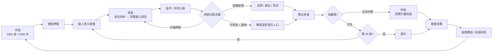
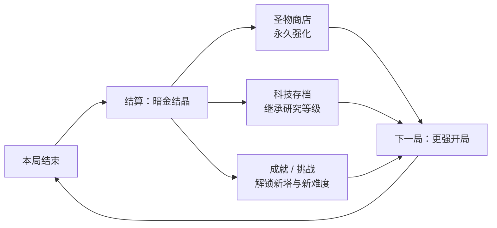
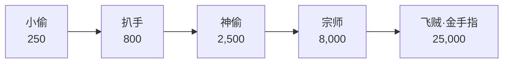
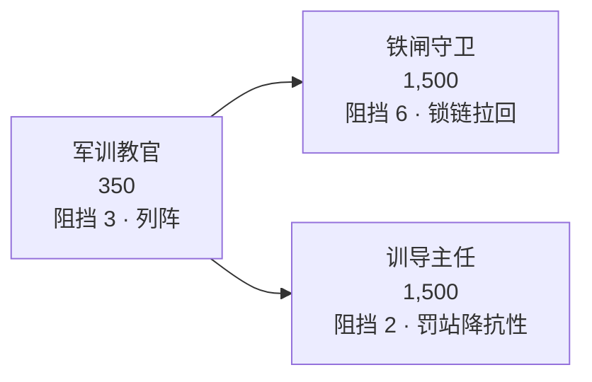
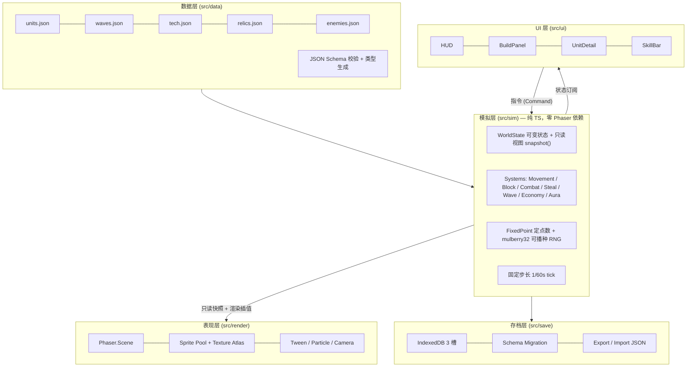

# 《窃金者 TD》开发策划案

> **网页版塔防游戏 · 参照魔兽争霸 III RPG 地图《华理小偷 TD》**
>
> 项目代号：`Goldvein` ｜ 文档版本：`v0.2` ｜ 状态：**M0 技术预研进行中（协作契约已冻结）**

---

## 决策摘要（v0.2 锁定）

| # | 事项 | 决策 | 影响 |
|---|---|---|---|
| D1 | 美术风格 | **像素风** | 产能高，包体小；资源总量降至 ≤3MB |
| D2 | 项目命名 | **《窃金者 TD》** | — |
| D3 | 波次总量 | **30 波**（非推荐项） | 成长曲线重算，单局缩至 22–35 min，工期 −2 周 |
| D4 | 敌人反击 | **删除**（非推荐项） | 移除「塔会不会死」变量；军训系重新定位 |
| D5 | 英雄单位 | **压到 M6** | M3 只需平衡 6 大战斗塔系 / 23 种战斗单位（全量 29 种可建造单位，见 §4.2 勘误），平衡工作 −40% |
| D6 | 移动端 | **桌面优先，M6 适配** | UI 单套设计，工期 −2 周 |
| D7 | 音效来源 | **全部 CC0 免费素材**（非推荐项） | 零成本；需建立素材来源台账 |
| D8 | 存档槽 | **3 槽** | 支持不同难度并行推进 |
| Q1 | 军训系定位（D4 衍生） | **转为「卡位延长窃金窗口」专精** | 重新绑定到窃金核心 |

> **目标形态**：纯单机离线（本地存档，无服务端） ｜ **技术栈**：TypeScript + Phaser 3 + Vite

---

## 目录

1. [项目概述](#1-项目概述)
2. [原作机制解构](#2-原作机制解构)
3. [核心玩法设计](#3-核心玩法设计)
4. [系统设计](#4-系统设计)
5. [数值设计](#5-数值设计)
6. [UI / UX 设计](#6-ui--ux-设计)
7. [美术与音频](#7-美术与音频)
8. [技术架构](#8-技术架构)
9. [开发计划](#9-开发计划)
10. [测试与平衡验证](#10-测试与平衡验证)
11. [风险与对策](#11-风险与对策)
12. [发布与轻运营](#12-发布与轻运营)
13. [决策记录](#13-决策记录)
14. [附录](#14-附录)

---

## 1. 项目概述

### 1.1 一句话定位

> 一款以**「偷钱」取代「杀怪赚钱」**为核心经济引擎的网页塔防游戏：你扮演暗巷神偷团伙的幕后主使，靠**窃取**敌人随身的钱袋滚雪球式发展，用偷来的钱武装更精良的盗贼与护卫，守住宝库，撑过 30 波围剿。

### 1.2 与参考对象的关系

| 维度 | 《华理小偷 TD》原作 | 本项目 |
|---|---|---|
| 平台 | 魔兽争霸 III 自定义地图（需 War3 客户端 + 对战平台） | 浏览器（桌面优先），零安装 |
| 人数 | 1–8 人合作，4 人各守一路 | 单人，一人守 2–4 路（按难度） |
| 核心经济 | 「小偷」攻击怪物时偷钱与木头 | **完整继承并系统化**，是全场第一设计支柱 |
| 内容承载 | 44 / 47 / 60 波，多作者改版碎片化 | 30 波 + 5 档难度 + 局外成长，全配置化 |
| 上手门槛 | 极高（地形卡位、黎叔归隐刷书等隐性知识，社区攻略动辄数千字） | **显性化教学**，把隐性技巧变成 UI 提示与可视化 |
| 美术 | War3 原生模型拼接 | 原创像素风 |
| IP | 校园/网络梗命名（黎叔、校长老妈、军训），版权归属混乱 | **原创世界观与命名**，仅借鉴机制（玩法机制不受著作权保护） |

### 1.3 设计支柱（Design Pillars）

一切设计决策以这四条为准绳，违反者砍掉：

1. **窃金即输出**
   一个塔的价值 = 它偷到多少钱 × 它挡住多少怪。攻击力同时是 DPS 和经济引擎，两者不分离。这是本作区别于《绿色循环圈》《元素TD》等一切其它塔防的根本。

2. **隐性技巧显性化**
   原作高手靠口口相传的「怪会停顿的那个点」「黎叔必须每波归隐」——本项目把这些**做成 UI 高亮、任务引导和数值提示**。目标是让第一次玩的人在 10 分钟内摸到乐趣，而不是先看 5000 字攻略。

3. **一分钟反馈，半小时深挖**
   30 秒内看到第一笔偷金入账（即时爽感）；单局 22–35 分钟的完整成长弧线，4 路资源分配、科技取舍、蜕变时机（长线决策）。

4. **离线可玩，进度不丢**
   纯前端、可断网、可 PWA 安装。所有成长写 IndexedDB（3 个存档槽），支持导出/导入存档。

### 1.4 目标用户

| 用户群 | 占比预估 | 需求 | 对应设计 |
|---|---|---|---|
| 怀旧党（玩过 War3 小偷系地图） | 35% | 找回偷钱手感、黎叔式养成 | 神偷系 5 级进化、点金术、★停顿点卡位 |
| 现代塔防玩家（玩过《保卫萝卜》《王国保卫战》） | 40% | 易上手、有成长、画面舒服 | 显性化教学、护甲克制提示、局外圣物 |
| 数值/挂机向玩家 | 25% | 滚雪球、暴击、数字变大 | 窃金暴击、钱包指数增长、科技树 |

### 1.5 目标平台与硬性指标

| 项目 | 指标 |
|---|---|
| 浏览器 | Chrome / Edge / Firefox / Safari 最近 2 个大版本 |
| 设备 | **桌面优先**（≥1280×720）；移动端浏览器 M6 适配 |
| 首屏加载 | ≤ 2s @ 10Mbps；首包 ≤ 1.2MB，全量资源 ≤ 3MB（像素风红利） |
| 帧率 | 60fps @ Intel i5-8250U 核显；同屏 250 敌人 + 500 投射物 |
| 内存 | ≤ 200MB（像素风资源少，下调自 v0.1 的 300MB） |
| 单局时长 | N1 ≈ 22–28 min；N5 ≈ 35–50 min |
| 存档 | IndexedDB，**3 个存档槽**，自动存档（每波结束 + 每 30s），可导出 JSON |

---

## 2. 原作机制解构

本章是立项依据。以下结论来自对原作多个版本的地图说明与社区攻略的交叉比对（来源见 [附录 14.4](#144-参考资料)）。

### 2.1 原作核心机制清单

| # | 机制 | 原作表现 | 判定 |
|---|---|---|---|
| 1 | **窃金（偷钱）** | 「小偷」攻击怪物时夺取金钱；**攻击越高偷得越多**；可同时偷钱与木头 | ✅ **灵魂，必须保留并深化** |
| 2 | 双资源 | 金币（建造/升级）+ 木材（科技/解锁） | ✅ 保留 |
| 3 | 多级进化塔系 | 小偷 → 杀手 → 飞机 → 黎叔；弓箭手 → 校长老妈 | ✅ 保留，收敛为 5 级 |
| 4 | 法师六大辅助 | 心灵之火（加攻）、嗜血（加攻速）、高级减速等 | ✅ 保留，作为「辅助乘区」 |
| 5 | 护甲/攻击类型克制 | 6 类护甲 × 6 类攻击，含**神圣甲**（最后 5 波） | ⚠️ 保留但**按难度分层**，避免劝退 |
| 6 | 飞行敌人 | 「所有怪物都为飞行的」 | ✅ 保留为波次变体，不是全局 |
| 7 | 敌人反击 | 「后期的怪会攻击，英雄放前面吸引火力」 | ❌ **删除**（决策 D4）——把「塔会不会死」这个额外变量移出平衡；军训系改为绑定窃金核心，见 [4.2.4](#424-军训系卡位延长窃金窗口) |
| 8 | 漏怪即扣命 | 有「结界守护」防漏怪 | ✅ 保留并强化视觉反馈 |
| 9 | 多路防守 | 4 人各守一路，4 菜鸟/4 老鸟 | ✅ **单机化：一人守 2–4 路** |
| 10 | 科技树 | 「中华科技」花费超千万；科技与数量要平衡 | ✅ 保留，分「局内 / 存档」两层 |
| 11 | 装备/商店 | 偷钱手套（倒挂金钩）大幅提升窃金 | ✅ 保留，M6 随英雄一起上线 |
| 12 | 农民/工人微操 | 工人有偷技与点金术；A 键杀自家农民 | ⚠️ 保留功能，**去掉反直觉操作** |
| 13 | 小精灵采木 | 5s/1木、5s/2木、1s/1木三档 | ✅ 保留为「木材产能」四档投资 |
| 14 | 黎叔刷书 | 黎叔 10 级归隐掉经验书，反复刷 | ❌ **删除**（伪操作量，无策略深度） |
| 15 | 存档继承 | 科技研究存档、30 层蜕变换材料、圣物商店 | ✅ 保留 → 单机版的**留存核心** |
| 16 | 挑战系统 | 飞羊、石像鬼、金币车、大魔王、装备 BOSS、团队 BOSS | ✅ 保留（团队 BOSS → 单人精英挑战） |
| 17 | 建筑师技能 | 领工资（60 倍基地产出）、荆棘丛林（硬控 3s，空中无效） | ✅ 保留，作为主动技能 |

### 2.2 必须改良的「历史包袱」

| 问题 | 原作表现 | 本项目对策 |
|---|---|---|
| **隐性知识壁垒** | 卡位点、归隐时机、手套优先级全靠口传，新手被老玩家「问候」 | ① 地面高亮「★最佳窃金位」② 内置 7 步新手任务 ③ 波次预告面板显示推荐塔系 |
| **伪操作量** | 反复点黎叔归隐刷经验书 | 删除；改为「装备 + 科技」的正向成长 |
| **额外平衡变量** | 后期敌人攻击防御塔，玩家必须同时管「输出」与「塔会不会死」 | 删除敌人反击（D4）；军训系改为「卡位延长窃金窗口」，仍保留「拦怪」的策略价值，但不再引入血量/修复系统 |
| **数值不可控** | 各改版作者随意加钱加怪，平衡崩坏（原作者公开鄙视「简单加金币的改图者」） | 全部数值进 JSON 配置表 + Schema 校验 + headless 自动跑批 |
| **多路对单人不可行** | 4 路要求 4 人 | 难度分层控制路数（N1–N2 开 2 路，N3+ 开 4 路） |
| **IP 归属混乱** | 校园梗命名、多作者互相改图 | 原创世界观与命名，规避商标与著作权风险 |
| **无进度保存** | 关掉 War3 一切归零 | IndexedDB 存档（3 槽）+ 圣物 + 科技继承 |

### 2.3 关键设计洞察：把「血量曲线」与「钱包曲线」解耦

原作的失衡根源是：**敌人血量**和**偷金产出**绑在同一条成长线上，作者只能整体调倍率，一调就崩。

本项目引入**「敌人钱包（Wallet）」**作为独立阀门：

- **血量 HP(n)** 决定难度曲线 —— 玩家需要多少 DPS 才能不漏怪
- **钱包 W(n)** 决定经济曲线 —— 玩家的钱从哪来
- 对**单个敌人**的总窃取量有硬上限（= 该敌人的钱包），偷光即不再产出

这一条改动带来三个结构性好处：

1. **经济曲线与难度曲线可独立调节**，平衡工作量下降一个量级。
2. **自然抑制「堆小偷」的退化策略**：堆小偷只是更快偷完同一个敌人，总收益被钱包封顶；玩家被迫思考「如何覆盖更多敌人」而非「如何堆更多小偷」——策略空间从数量转向布局。
3. **产生可量化的平衡指标**：`窃金覆盖率 = 实际窃取 / 全波敌人钱包总量`，目标区间 **65%–80%**。这个指标可以被 headless 模拟器自动测出，成为核心验收项。

---

## 3. 核心玩法设计

### 3.1 单局循环（Core Loop）



**单波节奏（约 35–50 秒）**

| 阶段 | 时长 | 玩家行为 | 系统反馈 |
|---|---|---|---|
| 备战 | 15s（可跳过/延长） | 建造、升级、分配资源 | 下一波敌人图标 + 护甲类型预告 |
| 交战 | 15–30s | 观察窃金效率、补塔、放主动技能 | 飘出 `+金币` 数字、窃金进度条（敌人钱包剩余） |
| 结算 | 3s | 决策 | 波次小结：本波窃金 / 理论钱包 / 覆盖率 / 漏怪数 |

### 3.2 局外循环（Meta Loop）



> **设计意图**：离线单机游戏没有社交留存，留存必须由**可感知的跨局变强**承担。蜕变（Ascension）是核心钩子——即使打不过，也能带着结晶离场，下一局明显更强。

### 3.3 操控与交互模型

三层操作深度，允许玩家只玩第一层也能通关 N1：

| 层级 | 操作 | 目标人群 | 是否必需 |
|---|---|---|---|
| L1 建造 | 拖放建塔、点升级、点出售 | 全部 | 必需 |
| L2 主动技能 | 建筑师技能（领工资 / 荆棘丛林）、神偷点金术 | 进阶 | 非必需 |
| L3 微操 | 军训系卡位点布置、单位重新部署、法师光环覆盖优化 | 硬核 | 非必需 |

**核心快捷键**

| 键 | 功能 | 键 | 功能 |
|---|---|---|---|
| `1`–`9` | 选择建造项 | `空格` | 暂停 / 继续 |
| `Q W E R` | 主动技能 | `F` | 切换倍速 1x / 2x / 4x |
| `S` | 出售选中单位 | `Tab` | 循环选中同类单位 |
| `Esc` | 取消建造 | `Ctrl+Z` | 撤销上一次建造（返还 100% 金币，限 10s 内） |

> `Ctrl+Z` 撤销是网页塔防的必备品——鼠标误点导致的挫败感远高于多给一点容错。

### 3.4 胜利与失败条件

| 项 | 规则 |
|---|---|
| **生命值** | 宝库生命，**N1→N5 = 50 / 30 / 20 / 10 / 5**（以 §4.8 的难度表为准）；每漏 1 个敌人扣 1 |
| **失败** | 生命值归零（唯一的失败条件——敌人不会攻击塔或宝库本体，见决策 D4） |
| **胜利** | 撑过第 30 波全部敌人 |
| **提前蜕变** | 第 20 波后任意时刻可主动「蜕变」结束本局并结算（打不过时的止损出口） |
| **结算货币** | `暗金结晶 = floor(累计窃金 / 1000) × 难度系数 × 成就系数` |

---

## 4. 系统设计

### 4.1 经济系统

#### 4.1.1 三条货币来源

| 来源 | 占比目标 | 说明 |
|---|---|---|
| **窃金（主）** | 70–80% | 神偷系单位攻击命中时夺取敌人钱包 |
| 击杀奖励（辅） | 15–20% | 击杀敌人获得固定小额金币（确保纯输出塔也有回报） |
| 木材采集 | 独立资源 | 小精灵持续产木；神偷窃金时按比例附带窃木 |

#### 4.1.2 窃金公式

```
单次窃取量 = min(
    敌人剩余钱包,
    StealBase × LevelMul × (1 + 0.02 × 塔攻击力) × (1 + 窃金科技加成) × (1 + 装备加成) × CritMul × (1 − 窃金抗性)
)

其中：
  StealBase        = 该塔的基础窃金系数（配置表字段）
  LevelMul         = 等级系数 = 1.0 / 1.35 / 1.85 / 2.6 / 3.8
  塔攻击力         = 当前面板攻击（含所有增益）
  窃金科技加成     = 每级 +12%，最高 5 级 = +60%
  装备加成         = 例：倒挂金钩 = +100%（M6）
  窃金抗性         = 敌人属性；「钱袋锁」= 70%，BOSS 飞升者 = 100%
  CritMul          = 暴击时 = 1.5 + 0.25 × 暴击效率等级（未暴击 = 1.0）
```

**关键约束**

- **每敌人总窃取 ≤ 该敌人钱包 W(n)**，偷光后该敌人对窃金塔不再产出金币（仍可被击杀获得击杀奖励）。
- 窃金**不依赖击杀**——敌人活着被偷光钱后仍可走完路径，此时只能靠输出塔击杀。这形成了「经济塔 vs 输出塔」的真实取舍。
- 敌人身上有可视化**钱包进度条**（金色），玩家一眼看出偷干净了没有。

#### 4.1.3 木材经济

| 单位 | 造价 | 产木 | 性价比（木/min/金） | 定位 |
|---|---|---|---|---|
| 笨拙的小精灵 | 1,200 金 | 5s / 1 木 | 0.0100 | 前期入门 |
| 纵情的小精灵 | 2,200 金 | 5s / 2 木 | 0.0109 | 中期替换 |
| 普通小精灵 | 4,800 金 | 1s / 1 木 | 0.0125 | 后期主力 |
| 高阶小精灵 | 9,000 金 | 1s / 2 木 | 0.0133 | 终局 |

> 性价比单调递增（0.0100 → 0.0133），形成标准的「投得越多、单位效率越高」投资曲线。玩家的约束不是「哪个划算」，而是「前期买不起贵的」——**这是一条资金门槛曲线，不是性价比选择**，与原作一致。

#### 4.1.4 建筑师技能

| 技能 | 冷却 | 效果 | 设计意图 |
|---|---|---|---|
| **领工资** | 90s（圣物可减至 40s） | 立即获得 `60 × 基地每秒产出` 金币 | 让「基地升级」这个看似被动的投资产生即时爽感 |
| **荆棘丛林** | 120s | 硬控所有地面敌人 3s | 紧急防漏；**对飞行无效**（保留原作设定，制造弱点认知） |

### 4.2 塔与单位体系

共 **9 类可建造单位 / 29 种**（英雄系 M6 上线，本期不计入）。

| 分类 | 数量 | 出处 |
|---|---|---|
| 6 大战斗塔系（神偷/弓箭/法师/军训/美女/炮塔） | 23 | §4.2.1–§4.2.6 |
| 工人系 | 1 | §4.2.8 |
| 小精灵（采木） | 4 | §4.1.3 |
| 科技塔 | 1 | §4.4.1 |
| **合计** | **29** | — |

> ### ⚠️ 勘误（M0 由 `data-arch` 发现，主策划确认）
>
> v0.2 声明「6 大系 / 23 种单位」，但 §4.1.3 的小精灵、§4.2.8 的工人、§4.4.1 的科技塔**同样是可建造单位却没被计入**——它们要参与建造 / 出售 / 撤销 / 人口流程，必须落在 `units.json` 里，不能另开一张表（分表会把建造管线 fork 成两套）。
>
> 因此 `TowerLine` 枚举扩为 **9 值**：`thief | archer | mage | drill | beauty | cannon | worker | sprite | tech`（`hero` 留 M6 加入，届时 10 值）。
>
> 另：v0.1 声明的「7 大系 / 34 种」本身也是笔误（实际只有 24 种）。

> **造价说明**：v0.2 全面上调了造价量级。v0.1 的造价结构只能消耗约 10% 的预期收入，属于数值设计错误，已在 [5.5](#55-经济分配目标) 修正。

#### 4.2.1 神偷系（核心经济塔）

| 等级 | 名称 | 造价 | 攻击 | 攻速 | 射程 | 攻击类型 | StealBase | 技能 |
|---|---|---|---|---|---|---|---|---|
| T1 | 小偷 | 250 | 8 | 1.0/s | 2.0 | 普通 | 4 | — |
| T2 | 扒手 | 800 | 20 | 1.1/s | 2.0 | 普通 | 8 | — |
| T3 | 神偷 | 2,500 | 45 | 1.2/s | 2.2 | 穿刺 | 14 | **潜行**：窃金效率 +25% |
| T4 | 宗师（黎叔致敬） | 8,000 | 110 | 1.3/s | 2.4 | 穿刺 | 26 | **点金术**：每 20s 秒杀血量 <15% 的敌人并全额夺取其剩余钱包 |
| T5 | 飞贼·金手指 | 25,000 | 280 | 1.5/s | 3.0 | 混乱 | 55 | **瞬移**：可免费重新部署；**破袋**：窃金无视**窃金抗性**（对「钱袋锁」敌人的 70% 抗性全额窃取；对 100% 完全免疫仍然无效） |



> **T4「宗师」是对原作「黎叔」的机制致敬**（原作中黎叔需 10 级归隐），但去掉了刷书循环，改为「点金术」这个有决策感的主动效果。

#### 4.2.2 弓箭系（廉价输出 / 多目标）

| 等级 | 名称 | 造价 | 攻击 | 攻速 | 射程 | 攻击类型 | 技能 |
|---|---|---|---|---|---|---|---|
| T1 | 弓手 | 200 | 14 | 0.9/s | 5.5 | 穿刺 | — |
| T2 | 多重弓手 | 600 | 26 | 1.0/s | 6.0 | 穿刺 | 多重箭 ×2 目标 |
| T3 | 弓手老妈 | 1,800 | 50 | 1.1/s | 6.5 | 穿刺 | 多重箭 ×3 目标 |
| T4 | 校长老妈（致敬） | 5,000 | 95 | 1.2/s | 7.0 | 穿刺 | 多重箭 ×4 目标 + 弹射 1 次 |

> **平衡注记**：原作明确说「弓手将是最垃圾的塔」，但前期又必须靠弓守。本项目把这个「前期强、后期弱」定位保留为**明确的设计意图**，并在 UI 上标注「过渡塔」，避免玩家误投资源。

#### 4.2.3 法师系（辅助乘区）

| 等级 | 名称 | 造价 | 攻击 | 攻速 | 射程 | 攻击类型 | 光环效果（不可叠加，取最高） |
|---|---|---|---|---|---|---|---|
| T1 | 法师 | 300 | 12 | 0.8/s | 4.5 | 魔法 | — |
| T2 | 萨满 | 900 | 24 | 0.9/s | 5.0 | 魔法 | **心灵之火**：半径 4 内友方塔 +25% 攻击 |
| T3 | 守望者 | 2,200 | 40 | 1.0/s | 5.0 | 魔法 | **嗜血**：半径 4 内友方塔 +30% 攻速 |
| T4 | 法师老爸 | 5,500 | 75 | 1.0/s | 5.5 | 魔法 | **高级减速**：半径 5 内敌人 −40% 移速 |
| T5 | 法师爷爷 | 14,000 | 140 | 1.1/s | 6.0 | 魔法 | **大法师光环**：全图 +15% 攻击 / +15% 攻速 / +10% 射程 |

#### 4.2.4 军训系（卡位延长窃金窗口）

**D4 决策后的重新定位**：删掉「敌人攻击防御塔」后，军训系不能靠「肉盾」立命。改为**直接服务于窃金核心**——把敌人拦在★停顿点附近，拉长它们处于窃金塔射程内的时间。

| 等级 | 名称 | 造价 | 攻击 | 攻速 | 射程 | 攻击类型 | 阻挡 | 技能 |
|---|---|---|---|---|---|---|---|---|
| T1 | 军训教官 | 350 | 26 | 1.0/s | 1.8 | 普通 | 3 | **列阵**：被阻挡的敌人移速 −40% |
| T2-A | 铁闸守卫 | 1,500 | 55 | 1.1/s | 2.0 | 普通 | 6 | **锁链**：每 15s 把最接近宝库的 1 个地面敌人拉回 3 格 |
| T2-B | 训导主任 | 1,500 | 70 | 1.0/s | 2.0 | 魔法 | 2 | **罚站**：被阻挡的敌人窃金抗性 −25%；周围 4 格内的神偷系塔窃金效率 +20% |



**机制联动说明**

```
敌人被阻挡 → 移速 −40%（列阵）
          → 停留在★停顿点的时间从 0.6s 拉长到 3–6s
          → 窃金塔多打出 3–6 次窃取
          → 若配训导主任，窃金抗性 −25%（对「钱袋锁」敌人是关键解法）
```

> ⚠️ **待验证假设**：这个联动是军训系存在的唯一理由，必须在 M1 原型中用数值验证「带军训 vs 不带军训」的单波窃金差额 ≥ 25%。若不成立，军训系应整系删除（回到 [决策记录](#13-决策记录) 重议 Q1）。

#### 4.2.5 美女系（减速与群伤）

| 等级 | 名称 | 造价 | 攻击 | 攻速 | 射程 | 攻击类型 | 技能 |
|---|---|---|---|---|---|---|---|
| T1 | 冰封美女 | 400 | 18 | 0.9/s | 4.0 | 魔法 | 命中减速 25%，持续 2s |
| T2 | 美人鱼 | 1,600 | 60 | 1.0/s | 4.5 | 魔法 | 群体减速 35% + 溅射 1.2 |
| T3 | 美人鱼老妈 | 7,000 | 130 | 1.1/s | 5.0 | 魔法 | 群体减速 50% + 范围冰冻 1.5s |

> **与军训系的区分**：美女系是**软减速**（不阻挡，敌人仍在走，但走得慢），覆盖范围大；军训系是**硬阻挡**（敌人原地不动），但只拦得住少数目标且必须贴路。两者在「延长窃金窗口」这个目标上是**互补而非替代**：美女系拉长全队通过时间，军训系锁住高价值目标。

#### 4.2.6 炮塔系（对城甲与群体）

| 等级 | 名称 | 造价 | 攻击 | 攻速 | 射程 | 攻击类型 | 技能 |
|---|---|---|---|---|---|---|---|
| T1 | 炮塔 | 450 | 55 | 0.6/s | 5.0 | 攻城 | 溅射半径 1.2 |
| T2 | 榴弹炮 | 1,800 | 130 | 0.7/s | 6.0 | 攻城 | 溅射半径 1.8 |
| T3 | 地狱火 | 8,000 | 300 | 0.8/s | 7.0 | 攻城 | 溅射半径 2.5 + 灼烧 5s |

> 原作反复强调「一定要多出炮塔，不要舍不得钱」，其原因是**城甲敌人只有攻城攻击能高效处理**。本项目保留这个知识，但通过波次预告面板直接告诉玩家。

#### 4.2.7 英雄系（M6 上线）

| 项 | 规则 |
|---|---|
| 上线时间 | **M6**（决策 D5）。M0–M5 的平衡范围内不包含英雄，保证 30 种塔的平衡先收敛 |
| 数量 | 最多 **2 个**（与原作一致，原作明确说「强烈建议出 2 个相同的，不然你绝对不够钱用」） |
| 造价 | 第一个 30,000 金 / 3,000 木；第二个 70,000 金 / 7,000 木 |
| 特性 | 攻击类型「混乱」，无视护甲克制（对神圣甲有效），可移动、可重新部署 |
| 装备栏 | 6 格 |
| 变身 | 10 级（+50% 攻击）、20 级（+100%，解锁第二技能）、30 级（终极形态，外观与特效变化） |
| 经验来源 | 击杀 + 窃金（窃金也涨经验，强化「偷」的主线） |

**专属装备（商店，M6）**

| 装备 | 价格 | 效果 |
|---|---|---|
| **倒挂金钩** | 9,000 金 | 窃金效率 +100%（原作明确提到此装备让偷钱速度大增 N 倍） |
| 点金手套 | 7,500 金 | 窃金暴击率 +15% |
| 疾风靴 | 5,400 金 | 移速 +40% |
| 贪婪之戒 | 15,000 金 | 击杀奖励 +50% |
| 时之沙漏 | 13,500 金 | 技能冷却 −20% |
| 探囊取物 | 12,000 金 | 神偷系射程 +15% |

> v0.1 中的「荆棘护甲（反弹伤害）」已随决策 D4 删除——没有敌人攻击塔，反弹机制无对象。

#### 4.2.8 工人系

| 单位 | 造价 | 功能 |
|---|---|---|
| 工人 | 150 金 | 建造加速；采集木材；**点金术**（对血量 <8% 的敌人秒杀并窃取其剩余钱包，冷却 15s/单位） |

> 移除了原作「按 A 键杀自己农民」的反直觉操作。工人回收改为「选中 → 出售按钮 → 返还 70% 造价」。

### 4.3 攻击 / 护甲克制矩阵

保留 War3 血统的深度，但**按难度分层生效**。

**标准倍率表（N3 及以上启用）**

| 攻击 ↓ / 护甲 → | 轻甲 | 中甲 | 重甲 | 城甲 | 神圣甲 |
|---|---|---|---|---|---|
| 普通 | 1.00 | 1.50 | 1.00 | 0.70 | **0.30** |
| 穿刺 | 2.00 | 0.75 | 1.00 | 0.35 | **0.30** |
| 魔法 | 1.25 | 0.75 | 1.50 | 0.35 | **0.50** |
| 攻城 | 1.00 | 0.50 | 1.00 | 2.00 | **0.30** |
| 混乱 | 1.25 | 1.25 | 1.25 | 1.25 | **1.00** |

**压缩倍率表（N1 / N2 启用）**

```
实际倍率 = 1 + (标准倍率 − 1) × 0.5，下限截断到 0.60
```

例：穿刺打城甲 = `1 + (0.35 − 1) × 0.5 = 0.675`。

**设计意图**

- 新手不被「我的塔打不动它」劝退，但仍能感受到克制存在（0.6–1.5 区间）。
- 高难玩家必须研究克制（0.3–2.0 区间，差 6.7 倍）。
- **神圣甲**自第 **26** 波起出现（BOSS 转生者 @26、飞升者 @27，以及 28–30 波的圣殿守卫），且只有「混乱」攻击（飞贼 T5、M6 后的英雄）能造成全额伤害。
  > **勘误**：v0.2 此处原写「只在第 28–30 波出现」，与 §4.5.2 的敌人表矛盾（转生者/飞升者本身就是神圣甲）。**以 §4.5.2 的具体数据为准**，本节文字已改。

### 4.4 科技系统

#### 4.4.1 局内科技（科技塔建造后解锁）

| 科技线 | 等级 | 每级效果 | 逐级造价（金 / 木） | 单线总投入 | 是否存档 |
|---|---|---|---|---|---|
| 窃金效率 | 5 | +12% 窃金 | 1,200 → 22,000 / 120 → 2,200 | 42,600 / 4,260 | ✅ 存等级 |
| 攻击强化 | 5 | +10% 攻击 | 1,000 → 19,000 / 100 → 1,900 | 36,700 / 3,670 | ✅ |
| 攻速强化 | 5 | +8% 攻速 | 1,000 → 19,000 / 100 → 1,900 | 36,700 / 3,670 | ✅ |
| 射程强化 | 5 | +6% 射程 | 800 → 15,000 / 80 → 1,500 | 29,000 / 2,900 | ✅ |
| 窃金暴击率 | 5 | +5%（基础 5%，上限 30%） | 1,400 → 25,000 / 140 → 2,500 | 48,500 / 4,850 | ✅ |
| 窃金暴击效率 | 5 | +25%（基础 150%，上限 275%） | 1,400 → 25,000 / 140 → 2,500 | 48,500 / 4,850 | ✅ |
| 人口上限 | 5 | +2 人口 | 700 → 12,800 / 70 → 1,280 | 24,700 / 2,470 | ✅ |
| 基地等级 | 5 | 解锁高阶塔 / 小精灵 / +木材产出 | 1,500 → 24,000 / 0 | 46,500 / 0 | ✅ |
| **合计** | 40 | — | — | **313,200 / 26,670** | — |

> 「逐级造价」按 2.0–2.3 倍递增（如 1,200 / 2,800 / 5,600 / 11,000 / 22,000）。

#### 4.4.2 存档继承规则

- 每项科技记录一个**存档等级**（0–5）。
- 新局开始时，每项科技**免费获得 `floor(存档等级 / 2)` 级**的起始加成（即最高 2 级白送）。
- 剩余等级仍需在本局花钱研究，但**造价按已有存档等级递减**：`实际造价 = 基础造价 × (1 − 0.08 × 存档等级)`。

> 这样既保证了「变强可感知」，又不会让高存档玩家一局无脑平推——他们仍需在局内做经济决策。

### 4.5 波次与关卡设计

#### 4.5.1 30 波结构表

| 波段 | 波次 | 主题 | 新增机制 | 主要敌人 | 设计目标 |
|---|---|---|---|---|---|
| 教学 | 1–4 | 认识窃金 | 建造 / 升级 / 窃金 | 街头混混（轻甲，慢） | 3 分钟内看到第一笔钱 |
| 扩展 | 5–8 | 空中威胁 | 飞行单位、多重箭 | 混混 + 蝙蝠（飞行） | 理解射程与多目标 |
| 分化 | 9–12 | 护甲分化 | 重甲、城甲出现 | 重装打手、装甲车 | 学会用攻城 / 魔法 |
| 强化 | 13–16 | 精英波 | 高钱包精英（窃金爆发点） | + 精英刺客 | 体验窃金爽点峰值 |
| 抗窃 | 17–20 | 反偷机制 | 「钱袋锁」窃金抗性 70% | + 铁钱袋商人 | 强迫补输出塔 + 用训导主任降抗性，打破纯偷流 |
| 高压 | 21–23 | 混合波 | 多类型同波 | 全类型混合 | 阵容完备度检验 |
| BOSS | 24–27 | 四个终极 BOSS | BOSS 战 + 掉落宝物 | 荒兽 / 心魔 / 转生者 / 飞升者 | 高潮与奖励 |
| 终局 | 28–30 | 神圣甲 | 仅混乱攻击有效 | 圣殿守卫 | 终极阵容检验 |

> 对应原作「从 21 关开始出强化敌人；最后 5 关为神圣甲」：本项目把「强化」落在 13 波（精英波），把「神圣甲」落在 28–30 波。

#### 4.5.2 敌人类型表

| 敌人 | 护甲 | 移速 | 特性 | 钱包系数 | 出现波次 |
|---|---|---|---|---|---|
| 街头混混 | 轻甲 | 慢 | — | ×1.0 | 1+ |
| 蝙蝠 | 轻甲 | 快 | **飞行** | ×1.1 | 5+ |
| 重装打手 | 重甲 | 慢 | 高血量 | ×1.3 | 9+ |
| 装甲车 | 城甲 | 很慢 | 极高血量，钱包 ×2 | ×2.0 | 12+ |
| 精英刺客 | 中甲 | 快 | 闪避 15% | ×2.5 | 13+ |
| 铁钱袋商人 | 重甲 | 中 | **窃金抗性 70%**，但钱包 ×2 | ×2.0 | 17+ |
| 圣殿守卫 | 神圣甲 | 中 | 免疫普通 / 穿刺 / 攻城 | ×3.0 | 28+ |
| **BOSS** 荒兽 | 城甲 | 慢 | 光环：周围敌人移速 +20% | — | 24 |
| **BOSS** 心魔 | **中甲** | 中 | 死亡时分裂为 2 个半血分身 | — | 25 |
| **BOSS** 转生者 | 神圣甲 | 中 | 复活一次（血量 50%） | — | 26 |
| **BOSS** 飞升者 | 神圣甲 | 快 | 飞行 + **窃金免疫（100% 抗性）** | — | 27 |

> 原「复仇者（攻击最近防御塔）」已随决策 D4 删除。BOSS 掉落宝物 = 随机高级装备或一次性大额金币，对应原作「地图中有 4 个终极 BOSS，打死暴宝物」。

#### 4.5.3 波次配置数据结构

所有波次为 JSON 驱动，示例见 [附录 14.2](#142-波次配置示例)。

```jsonc
{
  "wave": 12,
  "prepTime": 15,
  "groups": [
    { "enemy": "thug",        "count": 12, "interval": 0.8, "delay": 0 },
    { "enemy": "armored_car", "count": 3,  "interval": 3.0, "delay": 6, "path": [0, 1] }
  ],
  "reward": { "gold": 120, "wood": 10 },
  "hint": { "recommendArmor": "fortified", "recommendAttack": "siege" }
}
```

### 4.6 地图与路径设计

**单人守 4 路**：4 条独立路径从地图四角出发，汇聚到中央的**宝库**。

```
┌─────────────────────────────────────────┐
│  [入口A]                    [入口B]     │
│     │                          │        │
│     │   ★停顿点          ★停顿点│        │
│     │                          │        │
│     └──────┐          ┌────────┘        │
│            │          │                 │
│         ┌──┴──────────┴──┐              │
│         │   宝库 (核心)   │              │
│         └──┬──────────┬──┘              │
│            │          │                 │
│     ┌──────┘          └────────┐        │
│     │                          │        │
│     │   ★停顿点          ★停顿点│        │
│     │                          │        │
│  [入口C]                    [入口D]     │
└─────────────────────────────────────────┘
```

**关键地形设计**

| 元素 | 规格 | 说明 |
|---|---|---|
| 路径长度 | 约 40 格 | 慢速敌人通过需 ~20s，快速 ~10s |
| 可建造区 | 路径两侧各 2 格 | 提供足够的塔位纵深 |
| **★ 停顿点** | 每路中段 1 处 | **敌人经过时停顿 0.6s**，此处为窃金最优站位；军训系的阻挡点应紧邻此处 |
| 宝库 | 中央 5×5 | 敌人抵达即扣 1 生命并消失 |

> **★ 停顿点是本项目对原作最重要的致敬**：原作高手攻略明确写道「怪来的时候会在一个地方稍微有一下停顿，而这个位置恰好可以打到那里」。本项目把这个隐性技巧**做成地面金色高亮**，并在新手任务中引导玩家把第一个神偷放在那里。

**难度与路数**

| 难度 | 开放路数 | 说明 |
|---|---|---|
| N1 / N2 | 2 路（A、C） | 单人可控 |
| N3 / N4 / N5 | 4 路 | 资源分配与注意力压力 |

### 4.7 局外成长系统

#### 4.7.1 蜕变（Ascension）

| 项 | 规则 |
|---|---|
| 触发 | **第 20 波后**任意时刻（本局 2/3 处），或通关第 30 波 |
| 结算 | `暗金结晶 = floor(累计窃金 / 1000) × 难度系数 × 成就系数` |
| 难度系数 | N1 = 0.6 / N2 = 1.0 / N3 = 1.6 / N4 = 2.4 / N5 = 3.6 |
| 成就系数 | 基础 1.0，各成就乘算（见 4.7.3） |
| 代价 | 本局结束，未花完的金币作废（结算只算**累计窃金**，鼓励多偷） |

> 为什么是第 20 波：30 波局的 2/3 处。此时玩家已体验到完整的成长曲线，但还没到终局内容——给出「止损离场」与「再撑 10 波」的真实抉择。

#### 4.7.2 圣物商店（永久强化）

| 圣物 | 等级上限 | 每级效果 | 每级价格（结晶） |
|---|---|---|---|
| 起始金库 | 5 | 起始金币 +500 | 100 / 200 / 400 / 800 / 1,600 |
| 起始木料 | 5 | 起始木材 +200 | 80 / 160 / 320 / 640 / 1,280 |
| 贪婪之手 | 10 | 窃金效率 +5% | 150 × 1.35^(n−1) |
| 扩建地基 | 5 | 塔位上限 +1 | 300 / 600 / 1,200 / 2,400 / 4,800 |
| 学徒契约 | 5 | 建筑师「领工资」CD −10s | 200 × 1.5^(n−1) |
| **解锁：光骑士** | 1 | 解锁军训系 T2-A「铁闸守卫」 | 1,500 |
| **解锁：美人鱼老妈** | 1 | 解锁美女系 T3 | 2,500 |
| **解锁：金手指** | 1 | 解锁神偷系 T5 | 6,000 |
| **解锁：法师爷爷** | 1 | 解锁法师系 T5 | 8,000 |

> **解锁类圣物是长线目标**：玩家为了 T5 飞贼会持续游玩，这是离线单机最重要的留存设计。30 波单局更短意味着「凑结晶」的循环更快，与解锁类圣物的节奏天然契合。

#### 4.7.3 成就与挑战

| 成就 | 条件 | 系数加成 |
|---|---|---|
| 滴水不漏 | 全程零漏怪通关 | ×1.25 |
| 原汁原味 | 不蜕变，直接打到第 30 波 | ×1.50 |
| 闪电战 | 通关耗时 < 25 min | ×1.20 |
| 专精 | 只使用单一塔系通关 | ×1.30 |
| 空手道 | 不建造任何法师系塔通关 | ×1.15 |
| 千金散尽 | 单局累计窃金 ≥ 150 万 | ×1.10 |
| 卡位大师 | 单局依靠军训系阻挡额外窃取 ≥ 10 万金币 | ×1.15 |
| **进阶挑战** | 荒兽 / 心魔 / 转生 / 飞升 / 挖矿（对应原作后期玩法） | 各 ×1.2–2.0 |

### 4.8 难度分级

| 难度 | 敌人血量 | 敌人钱包 | 克制倍率 | 起始金币 | 起始木材 | 生命 | 开放路数 | 目标人群 |
|---|---|---|---|---|---|---|---|---|
| **N1 新手** | ×0.60 | ×1.40 | 压缩 | 3000 | 2000 | 50 | 2 | 首次游玩 |
| **N2 标准** | ×1.00 | ×1.00 | 压缩 | 2000 | 1500 | 30 | 2 | 普通玩家 |
| **N3 高手** | ×1.60 | ×0.90 | 标准 | 1500 | 1000 | 20 | 4 | 熟练玩家 |
| **N4 地狱** | ×2.40 | ×0.80 | 标准 | 1000 | 800 | 10 | 4 | 老手 |
| **N5 疯狂** | ×3.60 | ×0.70 | 标准 + 神圣甲全程 | 800 | 500 | 5 | 4 | 挑战者 |

> **难度越高，敌人钱包越少**——这是本作的核心难度哲学：高难度不只是怪更硬，而是**你的经济被压缩**，逼迫精算每一分钱。这个设计比单纯堆血量高级得多。

---

## 5. 数值设计

### 5.1 核心成长公式

| 项 | 公式 | 说明 |
|---|---|---|
| 敌人血量 | `HP(n) = 60 × 1.283^(n−1)` | 28.3% / 波 |
| 敌人钱包 | `W(n) = 32 × 1.20^(n−1)` | 20% / 波 |
| 每波敌人数量 | `Q(n) = 6 + floor(0.8 × n)` | **规划参考，非逐波要求**；实际以 `waves.json` 的设计为准 |
| 每波**理论总钱包** | `G(n) = Σ(该波各敌人数量 × W(n) × 该敌单体系数)` | 经济上限。**必须乘 §4.5.2 的单体钱包系数** |
| 窃金覆盖率 | `实际窃取 / G(n)` | **目标 65%–80%** |

> ### ⚠️ v0.2 勘误（M0 由 `data-arch` 发现，主策划确认）
>
> **v0.2 的 §5.2 表只算了 `Q(n) × W(n)`，漏乘了 §4.5.2 的单体钱包系数**（蝙蝠 ×1.1、装甲车 ×2.0、精英刺客 ×2.5、铁钱袋商人 ×2.0、圣殿守卫 ×3.0…），血量表同理。实测漏乘使累计理论钱包**少算 1.88 倍**，直接导致 §5.5 的经济分配目标失去依据——这正是 v0.2 声称已修正的「造价与收入量级失配」错误换了个形式复发。
>
> 同时发现**曲线过度后置**：原指数下第 26–30 波占累计钱包 **73–76%**，前 25 波几乎没有资金铺塔。
>
> 本次一次性修正，三条改动：
>
> | 改动 | 原值 | 新值 | 目的 |
> |---|---|---|---|
> | `baseWallet` | 10 | **32** | 抬高前期基数，前中期有真实经济；32 使支出/收入比落进 80–90% |
> | `walletIndex` | 1.29 | **1.20** | 压平后置度：`1.20^29 = 198×`，原 `1.29^29 = 1606×` |
> | `baseHp` | 40 | **60** | 抬高基数 |
> | `hpIndex` | 1.38 | **1.283** | 保持比值 `1.283/1.20 = 1.069` ≈ 原 `1.38/1.29 = 1.07`，**净难度爬升仍 ≈4 倍** |
>
> **比值（1.069）是最关键的一阶参数，不是绝对值。** 上述四个是**起点值，不是结论**——最终必须由 `balance-eng` 用 headless 模拟器标定到 §5.4 的验收区间。

### 5.2 关键波次数值表（**机器计算**，N2 基准）

下表由 `data-arch` 从 `waves.json` 实际 30 波组合 + §4.5.2 单体系数**计算得出**（不是手推），已随 `validate-data` 通过校验。

| 波次 | 每波总钱包 | 累计（约） |
|---|---|---|
| 1 | 192 | 192 |
| 5 | 690 | 2,100 |
| 10 | 2,509 | 9,600 |
| 15 | 11,585 | 34,200 |
| 20 | 41,911 | 110,000 |
| 25 | **142,458** | 335,000 |
| 30 | **633,004** | **2,204,577** |

**关键聚合指标**

| 指标 | 值 | 目标 | 判定 |
|---|---|---|---|
| 累计理论钱包 | **2,204,577** | 见下方支出侧说明 | ⚠️ |
| 敌人总血量 | **17,748,915** | — | 待标定（**M2 已证明不可通关**，见 §5.6） |
| 敌人总数 | 522（非 BOSS 波 422） | — | — |
| 击杀奖励 / 钱包 | **374,778（17.00%）** | 15–20% | ✅ |
| 波次结算奖励 | 19,209 金 / 1,857 木 | — | — |
| 总收入（窃金 70% + 击杀 + 波次） | **1,937,191** | — | — |
| §5.5 支出合计 | 1,293,200（**待重算**） | — | ⚠️ |
| **支出 / 收入比** | **66.8%** | 80–90% | ❌ **待重算** |
| **第 26–30 波占累计钱包** | **74.0%** | 「压平」 | ⚠️ **未达成**，见 §5.3.1 |

> ### ⚠️ 本轮两次数值变动的说明（§5.2 已同步）
>
> 1. **契约 §13.5 的 BOSS 钱包系数**（荒兽 ×12 / 心魔 ×12 / 转生者 ×16 / 飞升者 ×20）修掉了 `w27` 的经济断崖（3,663 → 73,264），使累计钱包从 1,797,342 抬到 **2,204,577**。上表的 `w25` / `w30` 与累计值因此更新。
> 2. **支出/收入比因此从 81.7% 掉回 66.8%** —— 收入涨了而支出侧仍是旧值。
>
> **裁决（契约 §14.12）**：**支出侧重算推迟到 `balance-eng` 重跑全矩阵之后**，本轮不动任何数值。理由有三：① §14.2 的科技改乘法**尚未端到端验证**；② BOSS 系数刚动过一轮，此时调支出是在两个移动目标上求交；③ 在"游戏是否可通关"还没有结论时调支出，属于过早优化。
>
> **重测后要实现的支出侧目标**（预先定好，避免又变成拍脑袋）：
>
> | 用途 | 目标占比 | 理由 |
> |---|---|---|
> | 塔建造与升级 | 50% | 由 55% 下调 |
> | **科技研究** | **35%** | **由 28% 上调** —— 契约 §14.2 把科技从装饰品改成了**主强度来源**（×40.8 DPS），它的投入必须与之匹配，否则它是全游戏性价比最高的东西 |
> | 小精灵与产能 | 8% | |
> | 装备与杂项 | 7% | |
>
> 即科技总额应从 313,200 上调到约 **×1.8**（≈576,000）。**具体数字由 `data-arch` 在重测后按此比例重算 `costPerLevel`。**

> ⚠️ **全部为起点值，待 [10.2](#102-headless-平衡模拟器) 的 headless 模拟器标定。** 上面这些数字能证明「曲线形状对、方向对、击杀奖励比例对」，**不能证明可玩性**。
>
> ⚠️ **唯一未达标的指标是尾部占比 70.9%**——这是模型层面的结构性问题，已在 §5.3 与风险表登记，留给 `balance-eng` 在 M2 处理。

### 5.3 难度爬升分析（重要设计参数）

```
血量增速 28.3% / 波，货币增速 20% / 波（比值 1.069）
叠加线性的数量增长后，净相对难度爬升 ≈ 4–5% / 波
→ 30 波累计相对难度 ≈ 3.8–4.3 倍（约 4 倍）
```

**这是一个刻意的设计**：如果两者同速，游戏全程难度不变，玩家会失去「越到后期越紧张」的体验；如果差距过大，后期会直接崩盘。4–5% / 波 是经过推演的合理区间，**但必须由 headless 模拟器验证**。

**主要调参旋钮**

| 旋钮 | 影响 | 调整方向 |
|---|---|---|
| `hpIndex` / `walletIndex` **的比值** | **净难度爬升**（最关键的一阶参数） | 目标维持在 **1.069** 左右 |
| `walletIndex`（1.20） | 经济曲线的陡峭与后置度 | ↑ 让后期更富但更后置，难度下降 |
| `hpIndex`（1.283） | 难度曲线陡峭度 | ↑ 让后期更难 |
| `baseWallet` / `baseHp` | 前中期经济与强度的**绝对水位** | ↑ 抬高全局水位，不影响曲线形状 |
| 单体钱包/血量系数 | 单类敌人的经济与血量权重 | 微调特定波次（**注意：改了会整体改变 ×1.88 这个均值**） |
| `StealBase` 数值 | 全局窃金效率 | ↑ 全局变简单 |
| 科技 / 塔造价曲线 | 玩家投资回收周期 | ↑ 拖慢节奏 |

> **一阶参数（指数与比值）控制曲线形状，二阶参数（系数与造价）控制局部微调**。所有参数集中在 `src/data/` 下的 JSON，改数值不需要改代码。

#### 5.3.1 ⚠️ 未解决的结构性张力：尾部占比 70.9%

`data-arch` 在 M0 发现并证明了一件事，**这是本项目最重要的数值结论**：

```
单指数模型下，第 26–30 波占累计钱包的 66%（基准曲线）～ 71%（实际组合）。

数学原因：G(n) = Q(n) × W(n)，其中 Q(n) 线性增长、W(n) 指数增长。
         乘积的尾部占比 = r^29 的权重 × Q(n) 的线性放大。
         对 r = 1.20：Σ(26..30)/Σ(1..30) ≈ 60%，乘上 Q(n) 的线性增长后 ≈ 66–71%。

要把尾部压到 ~40%，需要 r ≈ 1.10 —— 但 1.10^29 = 15.9×，
后期几乎没有成长感（玩家在最后 5 波感觉不到变强）。
```

**结论：单指数模型在 30 波下无法同时满足「前中期有钱」与「后期有成长」。这是模型问题，不是取值错误。**

**后果**：前 25 波只能拿到约 29% 的钱（≈52 万），而 §5.4 要求第 10 波有 6–9 座塔、第 20 波科技 10–16 级——**在模拟器验证之前，无法确认这个资金是否够用。**

**处理**：
1. 「支出/收入比 80–90%」已**降级为 M3/M4 门禁**，不是 M0 结论。
2. 给 `balance-eng` 的 mandate：**四个常量必须与成本曲线联合求解，且必须把尾部占比作为一等约束处理**，不能只看总量。
3. **登记的备选模型**（M2 评估，本轮不实现）：把「单体的钱包 × 敌人数」乘积模型，换成「**每波总收入曲线 + 按敌人数反推单体钱包**」——

```
T(n) = T₁ × g^(n−1)          // 每波总收入直接控形（g ≈ 1.13 → 总增长 ≈ 36×）
W(n) = T(n) / Q(n)           // 单体钱包反推，不再被 Q(n) 的线性增长放大尾部
```

这样总收入的**形状可独立控制**，与敌人数解耦。代价是 `W(n)` 不再是干净的指数式，配置表解读变复杂。

### 5.4 单局经济验收指标

| 指标 | 目标值 | 验证方式 |
|---|---|---|
| 窃金覆盖率 | 65%–80% | headless 模拟输出 |
| **支出 / 收入比** | **80%–90%** | headless 模拟输出（防 v0.1 的「钱花不完」错误）。**M0 裁决：本指标降级为 M3/M4 门禁，不是 M0 结论**——M0 实测 81.7%，但需 `balance-eng` 独立复算 |
| **尾部占比（第 26–30 波占累计钱包）** | ≤ 50% | headless 模拟输出。**当前 70.9%，未达标**，见 §5.3.1 |
| 漏怪率 | < 2%（熟练玩家 0） | 模拟 + 人工 |
| 波次末金币余量 | 波收入的 10%–40% | 模拟（过高说明无脑，过低说明憋屈） |
| 第 10 波时塔数量 | 6–9 座 | 模拟 |
| 第 20 波时已解锁科技等级 | 合计 10–16 级 | 模拟 |
| 带军训 vs 不带军训的单波窃金差额 | **≥ 25%** | 模拟（军训系的存在性验证） |
| 通关时间 | N1 22–28 min / N5 35–50 min | 人工计时 |
| 玩家操作密度 | 20–60 APM | 录屏抽样 |

### 5.5 经济分配目标

**这是修正 v0.1 数值错误的核心表。** v0.1 中累计总钱包 410 万，但塔 + 科技的总投入仅约 18 万，等于玩家会有 20 倍余钱——游戏会在第 15 波之后彻底失去经济压力。

| 用途 | 目标占比 | N2 基准金额（基于 **154 万**到手收入） | 对应内容 |
|---|---|---|---|
| 塔建造与升级 | 55% | ~85 万 | 约 35 座塔（含升到 T3–T5） |
| 科技研究 | 28% | ~43 万 | 8 条线 × 5 级 = 313,200 金 |
| 小精灵与产能 | 10% | ~15 万 | 约 8–10 只小精灵 |
| 装备与杂项 | 7% | ~11 万 | M6 英雄装备；本期为备用金 |
| **合计** | **100%** | **~154 万** | — |

**反推验证**：一座满级神偷系塔（T1→T5）累计造价 = 250 + 800 + 2,500 + 8,000 + 25,000 = **36,550 金**。8 座即 29 万；法师系满级单座 22,900，10 座即 23 万；炮塔 / 美女 / 弓箭合计约 15 万。塔总计 **67 万**，加上中后期补塔与升到 T3–T5 的其余单位，与 85 万目标吻合。

> **支出/收入比 = 1,290,000 / 1,540,000 ≈ 84%**，落在 §5.4 的 80–90% 目标区间内。**这两个数字都是一阶估算，必须由 headless 模拟器验证。**

> **注意**：木材独立核算。科技全解锁需要 26,670 木；神偷系窃金附带窃木（`stealWoodRatio = 3‰`）贡献约 4,500 木，其余 ≈ 22,000 木由小精灵产能覆盖（约 7 只高阶小精灵 × 120 木/min × 28 min ≈ 23,500）。

---

## 6. UI / UX 设计

### 6.1 界面布局

```
┌──────────────────────────────────────────────────────────────┐
│ ① 资源栏  💰 12,450   🪵 340   👥 14/20   🌊 14/30   ❤ 28/30 │
├────┬────────────────────────────────────────────┬────────────┤
│ ⑥  │                                            │ ④ 单位详情 │
│ 技 │                                            │ ┌────────┐ │
│ 能 │            主游戏视口                       │ │ 神偷 T3│ │
│ 栏 │            (1280×720 逻辑分辨率)            │ │ 攻击 45│ │
│    │                                            │ │ 窃金/秒│ │
│ 🏦 │                                            │ │  +62   │ │
│ 🌿 │                                            │ │ [升级] │ │
│    │                                            │ │ [出售] │ │
├────┴────────────────────────────────────────────┴────────────┤
│ ② 建造面板  [神偷系][弓箭系][法师系][军训系][美女系][炮塔系]   │
│ ③ 波次预告  下一波: 3× 装甲车(城甲) · 12× 混混  ⚠ 需要攻城攻击 │
│ ⑤ [⏸ 暂停] [▶ 1x] [⏩ 2x] [⏭ 4x] [🔄 撤销]                    │
└──────────────────────────────────────────────────────────────┘
```

| 编号 | 区域 | 关键设计 |
|---|---|---|
| ① | 资源栏 | 金币变化时数字滚动 + 绿色/红色闪烁；窃金时飘字 |
| ② | 建造面板 | 分类 Tab；每项显示造价、是否买得起（灰显）、一句话定位（「过渡塔」/「核心」/「卡位」） |
| ③ | 波次预告 | **本作最重要的 UX 改良**：直接告诉玩家下一波的护甲类型与推荐攻击类型 |
| ④ | 单位详情 | 显示攻击、攻速、射程、**窃金/秒（关键指标）**、DPS、已窃取总额 |
| ⑤ | 控制栏 | 倍速、暂停、撤销 |
| ⑥ | 技能栏 | 主动技能 + 冷却环 |

### 6.2 关键交互流程

**建造**
```
点击建造项 → 光标变为该塔预览 → 显示射程圈与合法/非法位置
→ 左键放置（扣金币，播放建造动画 0.3s）→ 可立即撤销（10s 内，Ctrl+Z）
```

**窃金反馈（核心爽点，必须做足）**
```
攻击命中 → 敌人身上弹出金色 "＋62" 飘字（上浮 + 淡出 0.6s）
        → 金币计数器滚动到新值
        → 敌人头顶钱包进度条（金色）减少
        → 暴击时飘字加大 + 屏幕轻微震动 + 特殊音效
```

**军训系卡位反馈（D4/Q1 衍生，需专门做）**
```
放置军训教官 → 显示其阻挡范围（红色虚线，覆盖路径）
敌人被阻挡 → 敌人脚下出现"锁"图标 + 移速条变红
           → 该敌人头顶钱包进度条下降速度明显加快（视觉上直接可见）
           → 结算面板显示"本波因卡位额外窃取 +X 金币"
```

> 最后一条是关键：**必须把军训系的贡献量化并显示出来**，否则玩家不会理解它的价值。这是「隐性技巧显性化」支柱的直接应用（对应成就「卡位大师」）。

**升级**
```
选中塔 → 右侧详情面板 → [升级] 按钮显示造价与属性增量预览
→ 点击 → 播放升级特效 → 属性条动画增长
```

### 6.3 新手引导（7 步任务链）

| 步 | 任务 | 触发 | 奖励 |
|---|---|---|---|
| 1 | 在金色高亮的★停顿点建造第一个小偷 | 开局 3s | +200 金 |
| 2 | 观察第一笔窃金入账 | 完成步 1 后首波 | 提示气泡「攻击力越高，偷得越多」 |
| 3 | 升级小偷到 T2 | 金币 ≥ 800 | +100 木 |
| 4 | 建造法师并确认光环生效 | 第 3 波开始 | 提示「辅助塔让你的小偷偷得更快」 |
| 5 | 建造炮塔应对城甲敌人 | 第 9 波 | 提示「攻城攻击对城甲 ×2」 |
| 6 | 在★停顿点旁建造军训教官，观察窃金窗口变长 | 第 13 波 | 提示「卡位能把敌人拦在射程里更久」 |
| 7 | 完成第一局（胜或败） | — | 首次结算翻倍 |

### 6.4 移动端适配（M6）

> **本期待办（M0–M5 不做）**。桌面优先是决策 D6。架构上用响应式布局预留接口，M6 再投入。

| 项 | 方案（M6 实施） |
|---|---|
| 布局 | 竖屏时建造面板改为底部抽屉，详情面板改为弹出卡片 |
| 触摸 | 单指点击 = 选中；长按 = 显示信息；双指捏合 = 缩放视口 |
| 性能 | 移动端自动降低粒子数量 50%，关闭屏幕震动 |
| 存档 | 与桌面端共用同一 IndexedDB Schema（但不跨设备同步，无服务端） |

### 6.5 可访问性

- **色盲友好**：护甲类型用「图标 + 文字」而非纯颜色区分（城甲 = 盾牌图标）。
- **字号缩放**：UI 支持 100% / 125% / 150% 三档。
- **降低动效**：提供「减少动态效果」开关（尊重 `prefers-reduced-motion`）。
- **音效独立开关**：BGM / 音效 **两条**独立音量条（**语音条推到 M6**，随英雄系上线——§7.3 的 40 条素材清单里本来就没有任何语音资源，M0–M5 渲染一条空的语音条是坏体验，明确不做）。详见[接口契约 §11.3](接口契约-v0.1.md)。

---

## 7. 美术与音频

> ### 🔄 决策变更：像素美术资产开发**暂缓**，改用**程序化占位美术**
>
> **变更时间**：M0 结束、M2 进行中 ｜ **决策人**：发起人 + 主策划
>
> **理由**：原方案需要 258 个手绘资源，是项目唯一一个**加 agent 也解决不了**的瓶颈。改成程序化生成后，它从无解的外部依赖变成一个有界的工程任务。
>
> **完整方案见 [`docs/art/占位美术方案.md`](art/占位美术方案.md)** —— 含视觉编码规则（塔系→轮廓、品阶→齿数、护甲→边框、属性→标记）、`SpriteSource` 可替换契约、接触表验收方式。
>
> **代价（明确接受）**：M2–M4 阶段游戏"不好看"。这是刻意取舍 —— **先把玩法和数值做对，再谈包装**。M2 的不可通关问题已经证明了这一点。
>
> **影响**：下方 §7.1 的规格仍然有效（尺寸、渲染约束、无障碍要求不变），但 §7.2 的**资产生产计划作废**，改为占位方案的实现。**M2 验收标准同步修订**（见 §9.2）。

### 7.1 美术风格：像素风（已定，决策 D1）

| 项 | 说明 |
|---|---|
| 风格 | 2D 像素风，暗色蒸汽朋克 / 黑帮题材，基准色板 32 色 |
| 调色 | 主色调暗蓝紫 + 金色高光（金色 = 金钱 = 核心机制，视觉上强化主题） |
| 塔尺寸 | 48×48 px（逻辑显示放大 2x） |
| 敌人尺寸 | 普通 32×32 / 精英 48×48 / BOSS 96×96 |
| 特效 | 窃金用金色像素粒子 + 硬币飞出；暴击用金色爆闪 |
| 工具 | Aseprite（精灵）/ Tiled（地图）/ TexturePacker（图集） |

**选像素风的收益（已计入排期）**

| 项 | 手绘方案 | 像素方案 | 收益 |
|---|---|---|---|
| 美术工时 | 3–4 个月 | 6–8 周 | **−50%** |
| 全量资源 | ~6 MB | ~1.5 MB | 首屏与移动端压力大幅下降 |
| 内存占用 | ~300 MB | ~200 MB | 低端设备可玩性提升 |

**代价（需接受）**：特效表现力弱于手绘；后期通过「粒子数量 + 屏震 + 金色爆闪」补偿打击感。

### 7.2 资源清单

| 类别 | 数量 | 规格 |
|---|---|---|
| 塔精灵 | 29 种 × 各 3 帧（idle / attack / upgrade）= 87 | 48×48 px PNG |
| 敌人精灵 | 11 类 × 3 变体（普通/精英/BOSS）+ 行走 4 帧 = 132 | 32×32 / 48×48 / 96×96 px |
| 地形图集 | 1 张 | 1024×1024，含路面、草地、可建造区、★停顿点 |
| 宝库 | 1 组（含 4 档受损状态） | 256×256 |
| UI 图集 | 1 张 | 1024×1024，图标 32×32 |
| 特效 | 20 组 | 128×128 序列帧 |
| 装备图标 | 6（M6） | 32×32 |
| 圣物图标 | 9 | 32×32 |
| 字体 | 2（中文 12px 点阵 + 数字位图字体） | — |

**总计约 258 个资源，图集化后约 1.6 MB。**（87 塔精灵 + 132 敌人 + 地形/宝库/UI 图集 3 + 特效 20 + 装备 6 + 圣物 9 + 字体 2）

> ### ⚠️ 上表是**未来接真实美术时**的清单，**不是当前的生产计划**
>
> 当前不生产任何手绘资源。改为**程序化生成**：由 `src/art/**` 从 `units.json` / `enemies.json` **确定性**生成全部 29 塔 + 11 敌的占位精灵（含 idle/attack/upgrade/walk 状态），新增单位**零代码改动**即获得美术。
>
> **尺寸与渲染约束（上表）继续有效**，程序化实现必须遵守：塔 48×48、普通敌 32×32、精英 48×48、BOSS 96×96、NEAREST + **整数倍**缩放（M0 已证明非整数倍会产生 shimmer）。
>
> 详见 [`docs/art/占位美术方案.md`](art/占位美术方案.md)。

### 7.3 音频设计（决策 D7：全部 CC0）

> **零成本方案**。不外包 BGM，全部使用 CC0 / 公共领域素材。

| 类别 | 数量 | 来源要求 |
|---|---|---|
| BGM | 4 | CC0（主菜单 / 常规波次 / BOSS 波 / 结算） |
| 波次预警音 | 1 | CC0 |
| 战斗音效 | 20 | CC0，按塔系归类复用 |
| 窃金音效 | 3 | CC0（普通 / 暴击 / 点金术） |
| UI 音效 | 8 | CC0（点击、建造、升级、出售、错误） |
| 胜利 / 失败 Jingle | 2 | CC0 |
| 环境音 | 2 | CC0（宝库低频嗡鸣、街道背景） |

**推荐素材库**：Freesound (CC0 筛选)、OpenGameArt (CC0)、Kenney.nl (CC0 全套游戏音效)、Pixabay Audio。

**必须执行的三条纪律**

1. **只取 CC0 / Public Domain**。CC-BY 会带来署名义务，CC-BY-NC 禁止商用，都要排除。
2. **建立素材来源台账**（`docs/audio-credits.md`）：记录每个文件的来源 URL、作者、许可类型、下载日期。这是被投诉时唯一的自证材料。
3. **BGM 撞车自检**：CC0 素材被大量小游戏复用，正式发布前用音频指纹工具（如 AcoustID）核查 4 首 BGM 是否已在知名游戏中被使用。若撞车，替换同库其它曲目。

> ⚠️ **风险提示**：原作中有作者自己都调侃来源不明的音乐（「看看是谁第一个知道胜利音乐是哪里来的」）。这种做法在网页端会直接收到 DMCA，且托管平台会下架站点，**绝不能复刻**。

---

## 8. 技术架构

### 8.1 技术选型

| 层 | 选型 | 理由 |
|---|---|---|
| 语言 | **TypeScript 5.x**（`strict: true`） | 配置表 + 模拟逻辑的类型安全是本项目可维护性的根基 |
| 游戏引擎 | **Phaser 3.80+** | 2D 塔防生态最成熟；WebGL 批量渲染、对象池、Tween、粒子开箱即用；首包 ~1.1MB gzip |
| 构建 | **Vite 5** | 秒级 HMR；`build.target: es2020`；资源哈希 |
| UI | **DOM 覆盖层**（原生 TS + 轻量组件） | 塔防 UI 是表单密集型，用 DOM 做比在 Canvas 里画控件快 5 倍且天然可访问 |
| 状态管理 | 自研轻量 EventBus + 不可变快照 | 避免引入 React 增加包体；UI 只需读快照 |
| 存档 | **IndexedDB**（`idb-keyval`） | 容量大（3 存档槽 + 设置）；比 localStorage 快 |
| 音频 | Phaser 内置 WebAudio | 不加依赖 |
| 测试 | **Vitest** + 自研 headless 模拟器 | 模拟层无渲染依赖，可直接在 Node 跑 |
| 代码规范 | ESLint + Prettier + `tsc --noEmit` | CI 门禁 |
| 部署 | 静态托管（GitHub Pages / Vercel / 自建 nginx） | 无服务端，零运维成本 |
| PWA | `vite-plugin-pwa` | 可安装、可离线、有桌面图标 |

### 8.2 分层架构



### 8.3 核心工程约定

| 约定 | 内容 | 为什么 |
|---|---|---|
| **模拟层零渲染依赖** | `src/sim/**` 不得 `import` Phaser | 让 headless 平衡模拟器可以在 Node 中跑完一整局 |
| **固定步长** | 逻辑 60Hz 定步长；渲染做插值 | 倍速切换、暂停、低帧率设备行为一致 |
| **定点数** | 所有游戏数值用 `× 1000` 的整数运算 | 避免浮点漂移导致 4x 倍速下结果与 1x 不一致 |
| **可播种 RNG** | 所有随机走 `mulberry32(seed)`，种子存存档 | 可复现的 bug、可回放、可自动化测试、可做挑战码分享 |
| **数据驱动** | 所有数值在 `src/data/*.json`，改数值零代码改动 | 策划可独立调平衡 |
| **Schema 门禁** | CI 中校验所有 JSON 符合 Schema | 配置表写错在 CI 就被拦住，而不是运行时崩 |
| **指令模式** | UI 不直接改状态，只发 `Command` 对象给 Sim | 天然支持撤销、回放 |

### 8.4 目录结构

```
tower-defense/
├─ src/
│  ├─ main.ts                      # 引导入口
│  ├─ sim/                         # ★ 纯模拟层（无渲染依赖）
│  │  ├─ world.ts                  # WorldState 定义
│  │  ├─ tick.ts                   # 定步长主循环
│  │  ├─ commands.ts               # 指令定义与处理
│  │  ├─ systems/
│  │  │  ├─ movement.ts            # 沿 waypoint 移动
│  │  │  ├─ block.ts               # ★ 阻挡与卡位（军训系核心）
│  │  │  ├─ combat.ts              # 索敌、攻击、伤害结算
│  │  │  ├─ steal.ts               # ★ 窃金系统
│  │  │  ├─ aura.ts                # 光环叠加（只取最高）
│  │  │  ├─ wave.ts                # 波次生成
│  │  │  └─ economy.ts             # 金币/木材/结算
│  │  ├─ fixed.ts                  # 定点数
│  │  └─ rng.ts                    # mulberry32
│  ├─ data/                        # ★ 数据驱动配置
│  │  ├─ units.json
│  │  ├─ enemies.json
│  │  ├─ waves.json
│  │  ├─ tech.json
│  │  ├─ relics.json
│  │  ├─ equipment.json            # M6
│  │  ├─ difficulty.json
│  │  ├─ schema/*.schema.json
│  │  └─ types.generated.ts        # 由 Schema 生成
│  ├─ render/                      # 表现层
│  │  ├─ scenes/{Boot,Menu,Game,Result}.ts
│  │  ├─ sprites/{Tower,Enemy,Projectile}.ts
│  │  ├─ pools/                    # 对象池
│  │  └─ effects/
│  ├─ ui/                          # DOM 覆盖层
│  │  ├─ hud.ts
│  │  ├─ build-panel.ts
│  │  ├─ unit-detail.ts
│  │  └─ styles.css
│  ├─ save/
│  │  ├─ store.ts                  # IndexedDB 封装（3 槽）
│  │  ├─ migrations/               # 版本迁移
│  │  └─ export.ts
│  ├─ audio/
│  └─ balance/
│      └─ simulate.ts              # ★ headless 跑批入口
├─ tools/
│  ├─ validate-data.ts             # Schema 校验
│  ├─ gen-types.ts                 # Schema → TS 类型
│  ├─ atlas-pack.ts                # 图集打包
│  └─ balance-report.ts            # 输出 CSV 报告
├─ public/
│  ├─ assets/{atlas,audio,fonts}/
│  └─ manifest.webmanifest
├─ docs/
│  ├─ 窃金者TD-开发策划案-v0.2.md
│  └─ audio-credits.md             # ★ CC0 素材来源台账
├─ tests/
│  ├─ sim/steal.spec.ts
│  ├─ sim/block.spec.ts            # 阻挡与卡位
│  ├─ sim/combat.spec.ts
│  └─ sim/economy.spec.ts
├─ vite.config.ts
├─ tsconfig.json
└─ package.json
```

### 8.5 关键系统实现要点

**窃金系统（`sim/systems/steal.ts`）**

```ts
// 伪代码：窃金结算
function resolveSteal(attacker: TowerState, target: EnemyState, world: WorldState): number {
  if (target.walletRemaining <= 0) return 0;                    // 钱袋已空
  if (target.stealResist >= 1000) return 0;                     // 窃金免疫（BOSS 飞升者）

  const base      = unitDef.stealBase * LEVEL_MUL[attacker.level];
  const atkBonus  = 1000 + 20 * attacker.attack;                // (1 + 0.02 × 攻击力)
  const techBonus = 1000 + techStealPct;                        // 窃金科技
  const equipBonus= 1000 + equipStealPct;                       // 装备（M6）
  const crit      = rollCrit(world.rng, attacker) ? critMul : 1000;
  const resist    = 1000 - effectiveStealResist(target);        // 含训导主任「罚站」减抗

  let amount = base * LEVEL_MUL[attacker.level] / 1000;         // 定点数还原
  amount = amount * atkBonus / 1000
                 * techBonus / 1000
                 * equipBonus / 1000
                 * crit / 1000
                 * resist / 1000;

  const actual = Math.min(amount, target.walletRemaining);
  target.walletRemaining -= actual;
  attacker.totalStolen += actual;
  return actual;
}
```

**阻挡与卡位系统（`sim/systems/block.ts`）—— D4/Q1 衍生，新增**

```ts
// 伪代码：阻挡结算（每 tick）
function resolveBlock(world: WorldState): void {
  const groundEnemies = world.enemies.filter(e => !e.flying && e.alive);

  for (const enemy of groundEnemies) {
    // 找到射程内、尚有阻挡余额、且最靠近敌人行进方向的塔
    const blocker = world.towers
      .filter(t => t.def.block > 0 && t.blockUsed < t.def.block && inRange(t, enemy))
      .sort((a, b) => dist(a, enemy) - dist(b, enemy))[0];

    if (blocker) {
      blocker.blockUsed++;
      enemy.blockedBy = blocker.id;
      // 「列阵」：被阻挡时额外减速
      enemy.speedMul = min(enemy.speedMul, 1000 - blocker.def.slowWhileBlocked);
    } else {
      enemy.blockedBy = null;
    }
  }
}
```

> **注意**：`blockUsed` 必须每 tick 重置。阻挡是「占位」而非「锁定」——敌人死亡或走远后立刻释放，否则高阻挡塔会永久占住名额。

**对象池与性能**

| 对象 | 池大小 | 说明 |
|---|---|---|
| 投射物 | 500 | 循环复用，超出则复用最旧的 |
| 伤害/金币飘字 | 300 | 用 BitmapText（不要用 `Text`） |
| 敌人精灵 | 250 | 按类型分池 |
| 粒子发射器 | 20 | 按特效类型复用 |

> ⚠️ **池容量与「弹无虚发」在数学上互斥**（M0 由 `engine-dev` 发现）。
> 稳态并发需求 = `射速 × 飞行时间`。池满时"复用最旧"意味着未命中的弹丸被丢弃，丢弃比例 = `1 − 池容量 / (射速 × 飞行时间)`。
> **本策划案的配置不会触发**（1.5 发/秒 × 35 塔 = 52 发/秒 → 池驻留 9.6s ≫ 飞行时间），但**不要把这个 500 当成"无限"用**——若 M2 出现高射速塔，必须同步上调池容量，否则窃金/伤害会静默丢失。详见[接口契约 §13.6](接口契约-v0.1.md)。

**渲染优化清单**
1. 所有精灵走同一图集（减少 draw call / texture swap）
2. `Phaser.BlendModes.NORMAL` 为主，少用 ADD（核显上 ADD 开销大）
3. 关闭不可见区域的精灵 `visible = false`（视口剔除）
4. 数字用 BitmapText 而非 `Text`（`Text` 每帧重绘 canvas，是最大性能杀手）
5. 像素风必须设 `textureFilter: 'NEAREST'` 且相机缩放取整数倍，否则像素会糊
6. 逻辑与渲染分离后，渲染在低帧率时自动降级（跳帧插值）

### 8.6 存档方案

```ts
interface SaveData {
  schemaVersion: number;          // 当前 1
  slots: Record<string, SaveSlot>; // ★ 3 个存档槽（决策 D8）
  activeSlot: string;
  settings: Settings;
  meta: {                         // 跨局继承的永久数据（与存档槽无关，全局共享）
    crystals: number;             // 暗金结晶
    relics: Record<string, number>;      // 圣物 id → 等级
    techArchive: Record<string, number>; // 科技 id → 存档等级
    achievements: Record<string, boolean>;
    stats: { totalRuns: number; totalStolen: number; bestWave: number; totalPlayTimeMs: number; };
  };
}

interface SaveSlot {
  id: string;
  name: string;
  seed: number;                   // RNG 种子
  difficulty: Difficulty;
  inRun: RunState | null;         // 未完成的局（断点续玩）
  updatedAt: number;
}
```

| 项 | 方案 |
|---|---|
| 槽位设计 | 3 槽，**`meta` 全局共享**（圣物/结晶/成就），**`inRun` 各自独立**（一局进度） |
| 自动存档时机 | 每波结束 + 每 30s + 页面 `visibilitychange` 隐藏时 |
| 版本迁移 | `migrations/` 目录下按 `v1→v2` 逐个函数迁移，迁移前自动备份到 `save.backup` |
| 导出/导入 | 导出为 base64 JSON 文件；导入时校验 `schemaVersion` 与简单校验和 |
| 防丢档 | 保留最近 3 个自动存档快照，可回滚 |
| 防作弊 | 离线游戏不做强反作弊，仅对结晶计算做一次 `Math.floor` 一致性校验；存档可编辑是单机游戏的合理特性 |

> **为什么 `meta` 全局共享**：如果结晶和圣物按槽位隔离，玩家重开一槽就等于从零开始，这会让「3 槽」变成「3 个独立小号」而非「3 条并行进度线」，与设计意图（重开不丢大号）相悖。

### 8.7 构建与部署

```bash
# 开发
pnpm dev                # Vite HMR

# 质量门禁（CI 执行）
pnpm typecheck          # tsc --noEmit
pnpm lint
pnpm validate-data      # JSON Schema 校验
pnpm test               # Vitest
pnpm balance --diff N2  # headless 平衡报告

# 构建
pnpm build              # → dist/，含 PWA manifest + Service Worker
```

- 部署为纯静态站点，无服务端。
- `vite.config.ts` 中设置 `build.target: 'es2020'`、图集走 CDN 可选。
- Service Worker 预缓存全部资源（全量仅 1.5MB），实现首次访问后完全离线可用。

---

## 9. 开发计划

### 9.1 人员配置假设

| 角色 | 人数 | 投入 | 职责 |
|---|---|---|---|
| 全栈 / 游戏程序 | 1 | 全职 | 架构、模拟层、渲染、UI、工具链 |
| 美术 | 1 | 0.5 全职（或外包） | 像素精灵、图集、特效、UI 皮肤 |
| 策划 / 数值 | 1 | 0.3 全职 | 配置表、平衡调参、文案 |
| 测试 | 1 | 0.2 全职 | 用例、兼容性、回归 |

> 若只有 1 人全职开发，总工期按 **1.4 倍**估算（约 17 周）。

### 9.2 里程碑

| 里程碑 | 周期 | 目标 | 交付物 | 验收标准 |
|---|---|---|---|---|
| **M0 技术预研** | 第 1 周 | 验证技术可行性 | 技术验证 Demo | 250 敌人 + 500 投射物稳定 60fps；定点数模拟在 1x/2x/4x 下结果完全一致；像素图集 NEAREST 渲染无糊边 |
| **M1 核心玩法原型** | 第 2–3 周 | 验证「偷金手感」+「卡位联动」 | 可玩原型（1 路 / 8 波 / 4 塔含军训） | 找 5 个陌生人试玩，**≥4 人表示「偷钱很爽」**，能自行说出「攻击越高偷得越多」；**带军训 vs 不带军训的单波窃金差额 ≥ 25%**（否则 Q1 需重议） |
| **M2 垂直切片** | 第 4–6 周 | 验证「一局好不好玩」 | ~~正式像素美术~~ **程序化占位美术** + 2 路 + 前 14 波 + 科技 + 商店 + 完整 UI | 15 分钟连续试玩无致命 Bug；试玩者能自主通关前 14 波；窃金覆盖率落在 65–80%；支出/收入比落入 80–90%。**美术验收改为**：① 占位美术覆盖全部 29 塔 + 11 敌，无缺失无共用 ② `SpriteSource` 替换契约就位且被 `src/render/**` 实际使用 ③ **接触表评审通过**（灰度与色盲模拟下仍能区分全部关键属性）④ 像素渲染保持无糊边（M0 的 NEAREST + 整数倍缩放结论不被破坏） |
| **M3 Alpha（全内容）** | 第 7–9 周 | 内容齐备 | 6 塔系 / 30 波 / 5 难度 / 局外成长 / 3 槽存档 | 全部内容可访问；headless 模拟 N2 通关率 100%、N3 60–80% |
| **M4 Beta（打磨）** | 第 10–11 周 | 平衡与性能 | 平衡终版 + 性能达标 + CC0 音频 + PWA | 性能指标全达标；20 名外部玩家测试；严重 Bug = 0；音频台账完整 |
| **M5 发布** | 第 12 周 | 上线 | 生产构建 + 部署 + 公告 | 线上可用；首屏 ≤2s；PWA 可安装 |
| **M6 运营迭代** | 第 13 周+ | 长线内容 | 英雄 + 装备 / 移动端 / 新难度 / 挑战榜 | 按数据反馈排优先级 |

### 9.3 排期时间线

```
第 1 周    ██ M0 技术预研
第 2-3 周  ████ M1 核心玩法原型        ← G1 决策点：偷金手感 + 卡位联动是否成立
第 4-6 周  ██████ M2 垂直切片          ← G2 决策点：一局是否好玩
第 7-9 周  ██████ M3 Alpha 全内容
第 10-11周 ████ M4 Beta 平衡与优化
第 12 周   ██ M5 发布
第 13 周+  ░░░░ M6 运营迭代（英雄 / 移动端 / 新内容）
```

> 从 v0.1 的 14 周压到 **12 周**，来源：30 波（−2 周）、像素风（美术并行度提升）、删除敌人反击（−0.4 周）、英雄推后（M3 平衡 −1.5 周）、移动端推后（−2 周），其中部分被造价重算与军训系重做的成本抵消。

**决策门（Gate）**

- **G1（M1 结束）**：① 偷金手感不成立 → 回到概念阶段重新设计核心机制，**不要继续做内容**；② 卡位联动差额 < 25% → 军训系整系删除，重新分配塔位预算。
- **G2（M2 结束）**：15 分钟试玩留不住人 → 砍掉局外成长，全部资源投到局内体验。
- **G3（M3 结束）**：平衡无法收敛 → 缩减到 3 档难度，优先保证 N2 体验完美。

### 9.4 需求优先级（MoSCoW）

| 优先级 | 内容 |
|---|---|
| **Must** | 窃金系统、神偷系、法师系、30 波、漏怪判定、3 槽存档、建造/升级/出售、HUD、性能达标 |
| **Should** | 军训系（卡位）、炮塔系、弓箭系、美女系、5 档难度、局外圣物、科技存档、蜕变、CC0 音效、PWA |
| **Could** | 英雄装备（M6）、成就系统、移动端优化（M6）、挑战码分享、粒子特效增强 |
| **Won't（本期不做）** | 联机合作、敌人反击、关卡编辑器、多语言（除中英）、云存档 |

> v0.1 中「军训分支」列在 Could，v0.2 提升到 Should——因为 D4 删除敌人反击后，军训系必须靠卡位机制重新立住，它不再是可选内容而是**验证 Q1 假设的必做项**。

---

## 10. 测试与平衡验证

### 10.1 单元测试（Vitest）

| 测试对象 | 用例 |
|---|---|
| 窃金公式 | 攻击力/科技/装备/暴击/抗性的乘法叠加正确；钱包封顶生效；偷光后返回 0 |
| 伤害矩阵 | 25 组攻击×护甲组合倍率正确；压缩模式在 N1/N2 正确截断到 0.6 下限 |
| **阻挡与卡位** | 阻挡名额分配正确且每 tick 释放；「列阵」减速叠加；「罚站」减抗正确作用于窃金结算；「锁链」拉回位置正确 |
| 经济结算 | 蜕变结晶公式正确；成就系数乘算正确；难度系数正确 |
| 定点数 | `×1000` 运算在极端值下不溢出；1x/2x/4x 模拟结果哈希一致 |
| 存档迁移 | v1→v2 迁移不丢字段；3 槽的 `meta` 共享与 `inRun` 隔离正确；损坏存档能被识别并回退到备份 |
| 配置表 | 所有 JSON 通过 Schema；引用完整性（波次引用的敌人 id 存在） |

### 10.2 Headless 平衡模拟器

这是本项目的**核心工程资产**。因为模拟层零渲染依赖，可以在 Node 中无人值守跑完整局。

```bash
pnpm balance --difficulty N3 --strategy greedy --runs 100 --out report.csv
```

**内置 AI 策略**

| 策略 | 行为 | 用途 |
|---|---|---|
| `greedy` | 有钱就升最贵的塔 | 模拟「无脑玩家」——若此策略能通关，说明太简单 |
| `balanced` | 按固定比例分配（经济 40% / 辅助 20% / 输出 40%） | 模拟「普通玩家」——用于定难度基线 |
| `optimal` | 贪心搜索最佳建造序列 | 模拟「高手」——用于找难度上限 |
| `noop` | 只造小偷不造输出 | 验证「纯偷流」是否可行（应当失败） |
| `noblock` | 同 `balanced`，但禁止建造军训系 | **验证 Q1 假设**：军训系带来的窃金差额 |

**输出报告字段**

| 字段 | 说明 |
|---|---|
| wave | 波次 |
| gold_earned / gold_spent | 本波收入 / 支出 |
| steal_coverage | 本波窃金覆盖率 |
| block_extra_steal | **因阻挡额外窃取的金币**（军训系价值量化） |
| leaks | 本波漏怪数 |
| dps_total / hp_total | 总 DPS / 敌人总血量（用于观察 TTK 曲线） |
| tower_count | 塔数量 |

**验收门槛（自动判定）**

| 策略 | 难度 | 目标通关率 |
|---|---|---|
| `balanced` | N2 | 100% |
| `balanced` | N3 | 60%–80% |
| `optimal` | N4 | 40%–60% |
| `optimal` | N5 | 5%–15% |
| `greedy` | N3 | ≤ 30%（超过说明太简单） |
| `noop` | N2 | 0%（必须失败，否则纯偷流破坏设计） |

**军训系存在性检验（Q1 验证）**

```
指标： block_extra_steal / total_steal
目标： ≥ 25%
判定： 若 `balanced` 与 `noblock` 两组的通关波次差 < 2 波，
      说明军训系没有实际价值 → 触发 G1 决策门，整系删除。
```

> 这套门槛把「平衡」从主观感受变成了 CI 里的红绿灯。每次改数值跑一次报告，曲线偏离目标区间就拒绝合并。

### 10.3 兼容性与性能测试矩阵

| 浏览器 | 版本 | 分辨率 | 设备 |
|---|---|---|---|
| Chrome | 最近 2 版 | 1920×1080 | Windows 桌面 |
| Edge | 最近 2 版 | 2560×1440 | Windows 桌面 |
| Firefox | 最近 2 版 | 1366×768 | 低端笔记本 |
| Safari | 最近 2 版 | 1440×900 | macOS |
| Chrome Android | 最近 2 版 | 1080×2340 | 中端安卓机（M6） |
| Safari iOS | 最近 2 版 | 1170×2532 | iPhone（M6） |

**性能基准场景**：加载第 28 波（30 敌人 + 全部塔），持续 60s，记录 min/avg FPS 与内存峰值。

### 10.4 玩家测试计划

| 轮次 | 时间 | 样本 | 目标 |
|---|---|---|---|
| 纸面测试 | M1 前 | 3 人 | 验证窃金公式、卡位联动与成长曲线合理性 |
| 手感测试 | M1 后 | 5 人 | 验证「偷钱爽不爽」+「卡位能不能被感知」（G1 门） |
| 垂直切片测试 | M2 后 | 15 人 | 验证「一局好玩吗」+ 7 步教学有效性（G2 门） |
| 封闭 Beta | M4 | 20 人 | 平衡、Bug、性能、留存意愿 |
| 公开测试 | M5 后 | 不限 | 数据反馈驱动 M6 排期 |

**关键测量**：新手首次窃金用时（目标 < 60s）、首次通关 N1 用时（目标 30–45 min，含重试）、D1 回访意愿（目标 > 50%）。

---

## 11. 风险与对策

| # | 风险 | 概率 | 影响 | 对策 |
|---|---|---|---|---|
| 1 | **窃金手感不成立**（核心玩法风险） | 中 | **致命** | M1 原型优先验证，且设 G1 决策门；准备 3 个备选核心机制（窃金暴击 / 窃金转化 DPS / 窃金连锁） |
| 2 | **军训系卡位无价值**（D4 衍生风险） | **高** | 中 | headless 模拟器 `balanced` vs `noblock` 对照；门槛 ≥25% 差额；不达标则整系删除并在 G1 重议 Q1 |
| 3 | **平衡无法收敛** | 高 | 高 | 钱包/血量双曲线解耦 + headless 模拟器 + CI 红绿灯；M2 阶段就开始跑批 |
| 4 | **造价与收入量级再次失配** | 中 | 高 | v0.1 已犯此错（成本仅消耗 10% 收入）；v0.2 引入「支出/收入比 80–90%」作为强制验收指标，纳入 CI。**M0 实测该错误已第三次出现**（v0.2 漏乘单体系数致收入低估 1.88×，修正后又超出目标 +17.6%）——根因是**我作为主策划用同一张错表做了「反推验证」，等于自己验自己**。对策：该指标降级为 M3/M4 门禁，由 `balance-eng` 独立验证，不由数据作者自证 |
| 4b | **经济曲线尾部占比 70.9%**（M0 发现的模型问题） | **高** | 高 | 单指数模型在 30 波下必然后置：前 25 波只有 29% 的钱，后 5 波 71%。要压到 40% 需 `walletIndex ≈ 1.10`，但那样后期失去成长感。**这是模型问题不是取值错误**。对策：① 指标降级为 M3/M4 门禁 ② 给 `balance-eng` 的 mandate 里把尾部占比列为一等约束 ③ 备选模型（每波总收入曲线 `T(n)=T₁×g^(n-1)` + 反推 `W(n)=T(n)/Q(n)`）登记在 §5.3.1，M2 评估 |
| 5 | **美术产能不足** | ~~中~~ **已消除** | ~~中~~ **低** | **已通过决策变更消除**：放弃手绘资产，改用[程序化占位美术](art/占位美术方案.md)（`src/art/**`，从 `units.json`/`enemies.json` 确定性生成，新增单位零代码改动）。原 258 个手绘资源是本项目唯一"加 agent 也解决不了"的瓶颈，现已转为有界工程任务。**残余风险**：占位美术的可读性不足（尤其 32×32 下区分 5 种护甲 + 飞行 + 窃金抗性）→ 对策：接触表评审（灰度 + 色盲模拟）作为 M2 硬验收，不通过则加大尺寸或减少同屏信息 |
| 6 | **Web 性能不达标** | 中 | 高 | M0 技术预研硬指标；对象池 + 图集 + BitmapText + NEAREST 过滤；移动端自动降级 |
| 7 | **原作 IP 风险** | 中 | 中 | 原创世界观与命名，不使用「华理」「黎叔」「校长老妈」等具体名称与美术；仅借鉴玩法机制（机制不受著作权保护） |
| 8 | **CC0 音频撞车或授权瑕疵**（D7 衍生） | **中** | 中 | 严格只取 CC0/PD；建立 `audio-credits.md` 台账；发布前用 AcoustID 自查 4 首 BGM 是否已被知名游戏使用 |
| 9 | **单机留存弱** | 高 | 中 | 局外圣物 + 科技存档 + 成就 + 蜕变止损出口；30 波短局反而加快结晶循环，与解锁类圣物节奏契合 |
| 10 | **范围蔓延** | 高 | 高 | MoSCoW 优先级 + 三道决策门；任何「Won't」项进 M6 待办，不插队 |
| 11 | **单一开发者风险（巴士因子）** | 中 | 高 | 架构文档化、配置表数据驱动、关键逻辑单测覆盖 > 70% |
| 12 | **玩家不理解护甲克制** | 中 | 中 | 波次预告面板直接给推荐；悬停显示倍率；新手期用压缩倍率 |
| 13 | **30 波中后期节奏单一** | 中 | 中 | 17 波引入「窃金抗性」打破惯性；21 波混合波；24–27 四连 BOSS；28–30 神圣甲收尾 |
| 14 | **存档损坏丢进度** | 低 | 高 | 3 份滚动快照 + 手动导出 + 迁移前自动备份 |

---

## 12. 发布与轻运营

### 12.1 发布清单

| 项 | 内容 |
|---|---|
| 托管 | Vercel / GitHub Pages（静态，免费） |
| 域名 | 自备（可选） |
| PWA | manifest + Service Worker，可安装到桌面/主屏 |
| 文案 | 商店页描述、玩法介绍、FAQ |
| 引导素材 | 30s 玩法演示 GIF、3 张截图 |
| 合规 | 无用户数据上传（纯本地），隐私政策可极简；**音频来源台账随仓库公开** |
| 素材自查 | 4 首 BGM 的 AcoustID 撞车自查报告 |

### 12.2 轻量运营方向（离线版特有）

| 方向 | 说明 | 优先级 |
|---|---|---|
| **挑战码分享** | 生成含随机种子的挑战码（如 `#seed=12345&N4`），分享后他人可复现完全相同的波次序列 | 高（零服务端成本，天然社交） |
| **数据埋点** | 本地记录（不后台上传）玩家卡在哪一波、平均通关时间，引导开发排期 | 高 |
| **英雄与装备** | M6 首个内容包（决策 D5） | 高 |
| **移动端适配** | M6（决策 D6） | 高 |
| **内置关卡编辑器** | 编辑路径 / 波次 / 初始资源，导出 JSON 分享 | 中 |
| **Mod 支持** | 文档化 JSON Schema，允许玩家自定义单位与波次 | 中 |
| **难度扩展包** | N6 / N7、新塔系、新 BOSS | 中 |
| **多语言** | 英文优先（中文已内置） | 低 |

### 12.3 变现（可选，本期不实现）

离线单机可选路径：**一次性买断（itch.io / Steam 页面）** 或 **纯免费 + 无广告**。
**明确不做**：内购抽卡、广告、强制联网。这与「离线可玩、进度不丢」的设计支柱冲突。

> ⚠️ 若未来考虑买断制，D7（全 CC0 音频）的规格需要重新评估——买断制产品用撞车率高的 CC0 BGM 会直接影响口碑。

---

## 13. 决策记录

### 13.1 已决策（v0.2 锁定）

| # | 事项 | 决策 | 决策理由 / 影响 |
|---|---|---|---|
| **D1** | 美术风格 | **像素风** | 美术工时 −50%（6–8 周 vs 3–4 月），全量资源 ≤1.5MB，内存 ≤200MB。接受特效表现力较弱的代价，用粒子+屏震补偿。 |
| **D2** | 项目命名 | **《窃金者 TD》** | 直白传达核心机制，搜索友好。已替换全文占位名。 |
| **D3** | 波次总量 | **30 波** | 单局缩至 22–35 min，更适配网页碎片时间。两条指数同步上调（1.26→1.38 / 1.20→1.29）以保持净难度爬升 ≈4 倍。工期 −2 周。 |
| **D4** | 敌人反击 | **删除** | 移除「塔会不会死」这个额外平衡变量，失败条件收敛为「生命归零」单一条。同时删除「荆棘护甲（反弹伤害）」装备。 |
| **D5** | 英雄单位 | **压到 M6** | M0–M5 只需平衡 30 种塔；英雄带等级+6 格装备+三阶段变身，是独立复杂度来源。M3 平衡工作 −40%。 |
| **D6** | 移动端 | **桌面优先，M6 适配** | UI 单套设计（省 2–3 周）。架构用响应式预留接口，不阻塞后续。 |
| **D7** | 音效来源 | **全部 CC0** | 零成本。代价是 BGM 撞车风险，需执行三条纪律（只取 CC0 / 建立台账 / AcoustID 自查）。 |
| **D8** | 存档槽 | **3 槽** | `meta`（圣物/结晶/成就）全局共享，`inRun` 各自独立——保证「重开不丢大号」。 |
| **Q1** | 军训系定位（D4 衍生） | **转为「卡位延长窃金窗口」专精** | 重新绑定到窃金核心：阻挡 → 移速 −40% → 停顿点停留时间 0.6s→3–6s → 多打 3–6 次窃取。T2-B「训导主任」额外提供 −25% 窃金抗性，成为「钱袋锁」敌人的解法。**需 M1 原型验证差额 ≥25%，否则整系删除。** |

### 13.2 决策带来的结构性变化（v0.1 → v0.2）

| 变化 | 说明 |
|---|---|
| 失败条件简化 | 从「生命归零 **或** 宝库被拆」收敛为「生命归零」单一条 |
| 军训系重做 | 从「肉盾 + 阻挡 + 二选一分支」改为「卡位 + 减抗 + 二选一分支」，新增 `sim/systems/block.ts` 与对应测试 |
| 塔系数量 | 7 系（含英雄）→ **6 系 / 23 种**（英雄系移入 M6）；同时修正 v0.1「7 大系 / 34 种」的数量笔误 |
| 造价全面上调 | 修正 v0.1 的数值失配（成本仅消耗 10% 预期收入）；新增「支出/收入比 80–90%」验收指标 |
| 成长指数上调 | 血量 1.26→1.38，钱包 1.20→1.29，保持净难度爬升 ≈4 倍 |
| 蜕变触发点 | 第 30 波后 → **第 20 波后**（30 波局的 2/3 处） |
| 新手引导 | 6 步 → **7 步**（新增第 6 步「军训卡位」） |
| 里程碑 | 14 周 → **12 周**；M3 从 4 周压到 3 周 |
| 新增衍生风险 | 「军训系卡位无价值」（高概率）与「CC0 音频撞车」（中概率）进入风险表，各配对策 |

### 13.3 尚未决策（留待 M6 或后续）

| # | 事项 | 触发条件 | 备选 |
|---|---|---|---|
| O1 | 是否做挑战榜 / 云端排行榜 | 若 M5 上线后留存数据低于预期 | 需引入服务端，与「纯离线」定位冲突，需重新评估 |
| O2 | 是否上架 Steam / itch.io 买断 | 若 Web 版数据良好 | 需重新评估 D7 音频规格与桌面封装（Tauri / Electron） |
| O3 | N6 / N7 难度设计 | M6 后玩家内容消耗速度 | 提高指数与压缩钱包 |
| O4 | 军训系若在 G1 被删除，塔位预算如何重分配 | G1 不达标 | 给神偷系加 T6，或给法师系加第二分支 |
| O5 | 关卡编辑器是否开放 | M6 内容消耗殆尽 | 文档化 JSON Schema + 导出分享 |

---

## 14. 附录

### 14.1 配置表 TS 类型定义

```ts
// ---------- 单位 ----------
export type AttackType = 'normal' | 'pierce' | 'magic' | 'siege' | 'chaos';
export type ArmorType  = 'light' | 'medium' | 'heavy' | 'fortified' | 'divine';
export type TowerLine  = 'thief' | 'archer' | 'mage' | 'drill' | 'beauty' | 'cannon'
                       | 'worker' | 'sprite' | 'tech'   // v0.1.2 扩：工人 / 小精灵 / 科技塔（§4.2 勘误）
                       | 'hero';                        // M6 启用，validator 禁止其出现在本期数据中

export interface UnitDef {
  id: string;
  name: string;
  line: TowerLine;
  tier: 1 | 2 | 3 | 4 | 5;
  cost: { gold: number; wood: number };
  attack: number;
  attackInterval: number;      // 秒/次
  range: number;               // 格
  attackType: AttackType;
  /** 窃金基础系数；0 表示非经济塔 */
  stealBase: number;
  /** 窃金暴击基础率（千分比，0 表示不暴击） */
  critRate: number;
  critMul: number;             // 千分比，如 1500 = ×1.5
  /** 光环效果（同级不叠加，取最高）。v0.1.2：单对象 `aura` 已弃用，只允许数组 `auras[]` */
  auras?: AuraDef[];
  /** 特殊技能（含「锁链」拉回等，参数在 params 中） */
  abilities?: Array<{ id: string; cooldown: number; params: Record<string, number> }>;
  /** 阻挡数（0 = 不阻挡）。D4 后这是军训系的核心字段 */
  block: number;
  /** 被本塔阻挡时敌人的额外减速（千分比）。对应技能「列阵」 */
  slowWhileBlocked: number;
  upgradesTo?: string[];       // 可升级目标（长度 >1 = 分支）
  sellsFor: number;            // 千分比，如 700 = 返还 70%
  icon: string;
  sprite: string;
  description: string;
  /** UI 定位标签，用于新手提示 */
  roleTag?: 'transition' | 'core' | 'support' | 'blocker' | 'endgame';
}

// ---------- 敌人 ----------
export interface EnemyDef {
  id: string;
  name: string;
  armorType: ArmorType;
  baseHp: number;
  baseWallet: number;          // 基础钱包（被窃金上限）
  speed: number;               // 格/秒
  flying: boolean;
  /** 窃金抗性，千分比；1000 = 完全免疫 */
  stealResist: number;
  /** 闪避率，千分比 */
  dodge: number;
  /** v0.1.2：击杀奖励 = 该敌人**当波钱包** × 本比率 / 1000。旧版固定绝对值 `bounty` 已废弃 */
  bountyRatio: { gold: number; wood: number };
  isBoss: boolean;
  /** 特殊机制钩子 id，如 'split' | 'revive' | 'aura_speed' */
  hooks?: string[];
  sprite: string;
  // 注：v0.1 的 `retaliate` 字段已随决策 D4 删除——敌人不会攻击防御塔。
}

// ---------- 波次 ----------
export interface WaveDef {
  wave: number;
  prepTime: number;
  groups: Array<{
    enemy: string;
    count: number;
    interval: number;          // 生成间隔（秒）
    delay: number;             // 本组延迟启动
    path?: number[];           // 指定路径索引；缺省 = 全部路径均分
  }>;
  reward?: { gold: number; wood: number };
  /** UI 提示，用于波次预告面板 */
  hint?: { recommendArmor?: ArmorType; recommendAttack?: AttackType; text?: string };
}

// ---------- 科技 ----------
export interface TechDef {
  id: string;
  name: string;
  maxLevel: number;
  effectPerLevel: number;      // 千分比增量
  /** 逐级造价数组，长度 = maxLevel（2.0–2.3 倍递增） */
  costPerLevel: Array<{ gold: number; wood: number }>;
  archivable: boolean;         // 是否写入存档等级
  requires?: string[];         // 前置科技/建筑
  description: string;
}

// ---------- 圣物 ----------
export interface RelicDef {
  id: string;
  name: string;
  maxLevel: number;
  effectPerLevel: number;
  crystalCostPerLevel: number[]; // 长度 = maxLevel
  /** 解锁类圣物：解锁某单位 */
  unlocksUnit?: string;
  description: string;
}

// ---------- 难度 ----------
export interface DifficultyDef {
  id: 'N1' | 'N2' | 'N3' | 'N4' | 'N5';
  name: string;
  hpMul: number;               // 千分比
  walletMul: number;
  /** 克制模式：'compressed' | 'standard' */
  counterMode: 'compressed' | 'standard';
  /** N5 全程启用神圣甲 */
  divineArmorAllWaves?: boolean;
  startGold: number;
  startWood: number;
  lives: number;
  openLanes: number;
  crystalMul: number;
  description: string;
}

// ---------- 存档（3 槽）----------
export interface SaveData {
  schemaVersion: number;
  slots: Record<string, SaveSlot>;   // ★ 固定 3 个键：'slot1' | 'slot2' | 'slot3'
  activeSlot: string;
  settings: {
    bgmVolume: number; sfxVolume: number;
    uiScale: number; reduceMotion: boolean;
    showDamageNumbers: boolean;
  };
  /** 全局共享的永久数据（不随存档槽隔离） */
  meta: {
    crystals: number;
    relics: Record<string, number>;
    techArchive: Record<string, number>;
    achievements: Record<string, boolean>;
    stats: {
      totalRuns: number;
      totalStolen: number;
      bestWave: number;
      totalPlayTimeMs: number;
    };
  };
}

export interface SaveSlot {
  id: 'slot1' | 'slot2' | 'slot3';
  name: string;
  seed: number;
  difficulty: DifficultyDef['id'];
  inRun: RunState | null;
  updatedAt: number;
}
```

### 14.2 波次配置示例

`src/data/waves.json`（节选，30 波结构）：

```json
[
  {
    "wave": 1,
    "prepTime": 20,
    "groups": [
      { "enemy": "thug", "count": 6, "interval": 1.2, "delay": 0 }
    ],
    "reward": { "gold": 50, "wood": 5 },
    "hint": { "recommendArmor": "light", "recommendAttack": "normal", "text": "把神偷放在金色高亮处" }
  },
  {
    "wave": 5,
    "prepTime": 15,
    "groups": [
      { "enemy": "thug", "count": 6, "interval": 1.0, "delay": 0 },
      { "enemy": "bat",  "count": 4, "interval": 1.5, "delay": 5, "path": [0, 1] }
    ],
    "reward": { "gold": 90, "wood": 8 },
    "hint": { "recommendArmor": "light", "recommendAttack": "pierce", "text": "空中单位来袭：多重箭能同时命中多个目标" }
  },
  // ↑ v0.1.2 修订：原示例为「10 混混 + 6 蝙蝠 = 16 只」，导致第 5→6 波敌人总数从 16 掉到 10
  //   （违反「非 BOSS 波单调不减」不变量）。已改为 6 + 4 = 10。本条为本节唯一偏离原始设计的示例。
  {
    "wave": 12,
    "prepTime": 15,
    "groups": [
      { "enemy": "thug",        "count": 12, "interval": 0.8, "delay": 0 },
      { "enemy": "armored_car", "count": 3,  "interval": 3.0, "delay": 6 }
    ],
    "reward": { "gold": 120, "wood": 10 },
    "hint": { "recommendArmor": "fortified", "recommendAttack": "siege", "text": "城甲敌人：只有攻城攻击能高效击穿" }
  },
  {
    "wave": 18,
    "prepTime": 15,
    "groups": [
      { "enemy": "thug",           "count": 14, "interval": 0.7, "delay": 0 },
      { "enemy": "merchant_lock",  "count": 5,  "interval": 2.5, "delay": 4 },
      { "enemy": "elite_assassin", "count": 4,  "interval": 2.0, "delay": 10 }
    ],
    "reward": { "gold": 200, "wood": 16 },
    "hint": { "recommendArmor": "heavy", "recommendAttack": "magic", "text": "钱袋锁：窃金抗性 70%。用训导主任「罚站」降低抗性，或补输出塔" }
  },
  {
    "wave": 27,
    "prepTime": 20,
    "groups": [
      { "enemy": "ascendant", "count": 1, "interval": 1, "delay": 0 }
    ],
    "reward": { "gold": 2000, "wood": 200 },
    "hint": { "recommendArmor": "divine", "recommendAttack": "chaos", "text": "最终 BOSS：飞升者窃金免疫，必须用混乱攻击（飞贼 T5）击杀" }
  },
  {
    "wave": 30,
    "prepTime": 25,
    "groups": [
      { "enemy": "temple_guard", "count": 20, "interval": 0.9, "delay": 0 },
      { "enemy": "ascendant",    "count": 2,  "interval": 6.0, "delay": 12 }
    ],
    "reward": { "gold": 5000, "wood": 500 },
    "hint": { "recommendArmor": "divine", "recommendAttack": "chaos", "text": "最后一波。只有混乱攻击能造成全额伤害。" }
  }
]
```

### 14.3 术语中英对照

| 中文 | 英文 | 说明 |
|---|---|---|
| 窃金 | Steal / Pickpocket | 核心经济机制 |
| 敌人钱包 | Wallet | 单敌人可被窃取的总量上限 |
| 窃金覆盖率 | Steal Coverage | 实际窃取 / 理论总钱包，目标 65–80% |
| 窃金抗性 | Steal Resist | 敌人属性；「钱袋锁」70%，飞升者 100% |
| 阻挡 | Block | 军训系单位拦截敌人的数量上限 |
| 卡位 | Block-Positioning | 用阻挡把敌人锁在★停顿点，延长窃金窗口（Q1 决策） |
| 停顿点 | Halt Point | 敌人经过时停顿 0.6s 的位置 |
| 光环 | Aura | 法师系的范围增益，同级不叠加 |
| 压缩克制 | Compressed Counter | N1/N2 的弱化克制模式 |
| 神圣甲 | Divine Armor | 仅混乱攻击有效的终局护甲 |
| 蜕变 | Ascension | 第 20 波后主动结束本局并结算 |
| 暗金结晶 | Dark Crystal | 局外货币 |
| 圣物 | Relic | 永久强化项 |
| 科技存档 | Tech Archive | 跨局继承的科技等级 |
| 支出/收入比 | Spend Ratio | 目标 80–90%，防「钱花不完」 |
| 定点数 | Fixed Point | ×1000 的整数运算，保证确定性 |

### 14.4 参考资料

本项目对原作机制的解构基于以下公开资料（外部内容，仅作研究用途）：

| 来源 | 内容 | 链接 |
|---|---|---|
| WC3Maps | 《华理TD[小偷-英雄]天堂版》地图说明（造塔防守类；开始时一定要造小偷；21 关起强化敌人；最后 5 关神圣甲；弓箭手多重攻击；法师六大辅助技能） | [wc3maps.com/map/394524](https://wc3maps.com/map/394524/TD-) |
| WC3Maps | 《华理小偷 5.13 可单机版》地图说明（起始 3000 钱/2000 木；小偷可偷钱和木头；英雄需买偷钱装备；后期怪会攻击需英雄吸引火力；所有怪物为飞行；多出炮塔） | [wc3maps.com/map/269441](https://wc3maps.com/map/269441/5.13) |
| 魔兽基地 | 《华理TD小偷Ⅱ》地图说明（4 人合作；4 个终极 BOSS 掉落宝物；44 波；需造结界守护防漏怪） | [ra216.com/…/102657](http://www.ra216.com/html/TDtafang/20263/102657.html) |
| 魔兽基地 | 《华理小偷06 (5.14 菜鸟版)》地图说明（巨魔法师减速前期极品；成熟美女群伤；弓箭手需尽快升级） | [ra216.com/…/82057](https://www.ra216.com/html/TDtafang/20259/82057.html) |
| 多多软件站 | 《华理 td 小偷加强版》特色说明（怪物 60 波；英雄可出 2 个；科技花费超千万；舰长等级重要；工人点金术；美女减速、军团击昏、小偷偷钱和木头、弓箭手多重箭） | [ddooo.com/softdown/116691](https://www.ddooo.com/softdown/116691.htm) |
| 百度贴吧 | 《魔兽 RPG-小偷疯狂科技攻略》（卡位点选择；小偷升级至飞机/黎叔；偷钱手套优先级；装备倒挂金钩提升偷钱速度；地形停顿点） | [tieba.baidu.com/p/549812426](https://tieba.baidu.com/p/549812426) |
| 百度知道 | 《华理小偷怎么玩》（盗贼可攻击三面敌人的位置选择；偷钱效率随等级；法师心灵之火/减速；冰封美女；黎叔进化与退役掉落经验书） | [zhidao.baidu.com/…](https://zhidao.baidu.com/question/318635352365737604.html) |
| KK 对战平台 | 《小偷 TD 循环》攻略（神偷积分；N1–N4 难度分层；+1 偷金 vs 暴击几率/暴击效率；成长塔【火魔塔】窃取 88 金币；小精灵三档采木 520/1100/2000；建筑师领工资 60 倍产出与荆棘丛林 3s 硬控对空无效） | [kkdzpt.com/fab/203014](https://www.kkdzpt.com/fab/203014/69a9446d3c522b2bc055d6ad) |
| KK 对战平台 | 《给新人的建议》（科技塔研究攻击/攻速/范围存档；30 层蜕变兑换圣物；35 层后怪不爆金币；装备 BOSS 六件套；黑暗挑战与团队 BOSS；荒兽/心魔/转生/飞升/挖矿） | [kkdzpt.com/fab/201520](https://www.kkdzpt.com/fab/201520/68ecf6384e126efe61f52362) |
| Bilibili | 《TD 华理小偷 5.13 可单机版 简易攻略》视频 | [bilibili.com/list/8286685](https://www.bilibili.com/list/8286685?oid=537148753&bvid=BV1ai4y1Y7zw) |

> **声明**：本项目为对上述地图**玩法机制**的学习与再创作，不复制其美术资源、代码、名称或文本内容。游戏玩法与机制不受著作权保护，但具体美术表达与代码受保护——本项目采用原创世界观与原创资源。

---

## 修订记录

| 版本 | 日期 | 作者 | 变更 |
|---|---|---|---|
| v0.1 | — | — | 初稿：完成原作解构、核心玩法、系统与数值设计、技术架构、排期与风险（44 波 / 7 塔系 34 单位 / 14 周） |
| v0.2 | — | — | **锁定 8 项待决策 + 1 项衍生决策**；波次 44→30 波并同步上调成长指数（血量 1.26→1.38，钱包 1.20→1.29），保持净难度爬升 ≈4 倍；删除敌人反击并重做军训系为「卡位延长窃金窗口」；英雄推后到 M6；确定像素风；音频改用全 CC0 并新增素材台账纪律；存档确定为 3 槽（meta 全局共享 / inRun 隔离）；**修正两处 v0.1 错误**：① 造价与收入量级失配（新增「支出/收入比 80–90%」验收指标与 [5.5 经济分配目标](#55-经济分配目标)）② 塔系数量笔误（34 种 → 实为 23 种）；里程碑 14 周→12 周；新增「军训系卡位无价值」与「CC0 音频撞车」两项风险 |

---

## 协作契约同步说明（随 M0 启动）

仓库已建立两份协作文件，与本文档共同构成 M0 的权威输入：

| 文件 | 作用 |
|---|---|
| [`AGENTS.md`](../AGENTS.md) | 多 agent 协作规则：独占路径所有权、工程铁律、汇报规范、禁止事项 |
| [`docs/接口契约-v0.1.md`](接口契约-v0.1.md) | 跨模块接口唯一真相：定点数约定、**9 张配置表契约**、Sim API、Command、SimEvent、Snapshot、音频资源契约（§11） |

接口契约冻结时同步了 **5 项修正**（契约优先，已回写正文）；**M0 期间另追加 8 项，共 13 项**：

| # | 本文档原描述 | 修正 | 原因 |
|---|---|---|---|
| 1 | 8.2 图：`WorldState 不可变快照` | **可变状态 + 只读视图 `snapshot()`** | 250 敌人 × 60fps 下纯不可变会产生严重 GC 压力 |
| 2 | 14.1：7 张配置表 | 补第 8 张 **`constants.json`** | §4.1.2 / §4.3 / §5.1 的公式常量（血量指数、等级系数、克制矩阵…）否则只能写死在代码里，违反「数据驱动」 |
| 3 | 4.2 各表攻速列「1.0/s」 | JSON 中 `attackInterval` 存**间隔秒**（定点） | 统一单位语义，避免「频率 vs 间隔」的经典填表错误。填表时必须做倒数转换 |
| 4 | 4.1.2：金币为整数 | 金币 / 木材也走 **×1000 定点** | 窃金为每次攻击结算的细粒度高频收入（一局数千次），逐次取整会系统性累积舍入误差 |
| 5 | 6.5：BGM / 音效 / 语音 三条音量条 | M0–M5 只做 **BGM + 音效两条**，语音条推 M6 | §7.3 的 40 条素材清单里本就没有语音资源（英雄系按 D5 推 M6），渲染一条空的语音条比没有更糟 |

**M0 期间由 `data-arch` 发现、主策划裁决追加的 8 项修正**（这是本项目最有价值的一次交叉审查——它找出的不是取数问题，而是设计错误）：

| # | 原文 | 修正 | 原因 |
|---|---|---|---|
| 6 | §5.1/§5.2 成长公式与数值表 | `baseHp` 40→**60**、`hpIndex` 1.38→**1.283**、`baseWallet` 10→**38**、`walletIndex` 1.29→**1.20** | v0.2 的表**漏乘 §4.5.2 单体钱包系数**（少算 1.88 倍）；且原指数使第 26–30 波占累计钱包 **73–76%**，前 25 波无钱铺塔。压平指数 + 抬高基数 + 保比值 1.069 |
| 7 | §4.2「6 大系 / 23 种单位」 | **9 类 / 29 种**，`TowerLine` 扩为 9 值 | 小精灵 / 工人 / 科技塔同为可建造单位却没计入，无处落表 |
| 8 | §4.5.2 心魔「英雄甲」 | **中甲** | `ArmorType` 只有 5 类，无英雄甲；中甲抵抗穿刺/魔法/攻城、弱于普通与混乱，**契合「死亡分裂」惩罚 AoE 的机制，并强化军训系（Q1）** |
| 9 | §4.3「神圣甲只在 28–30 波」 | **第 26 波起** | 与 §4.5.2 的转生者/飞升者（本身即神圣甲）矛盾，以具体数据为准 |
| 10 | `EnemyDef.bounty` 固定绝对值 | **`bountyRatio`**（占**当波钱包**的千分比） | 绝对值无法随钱包曲线成长；名为 `gold` 却存比率会让 `engine-dev` 误实现，实测会使击杀奖励仅占钱包 **0.04%**（要求 15–20%） |
| 11 | `aura` 单对象 | **`auras[]` 为唯一规范字段** | 两者并存会让引擎读一个、数据写另一个 → 效果**静默失效且无报错** |
| 12 | §14.1 缺 `EquipmentDef` 定义 | 采纳 `data-arch` 自拟类型 | v0.2 漏定义，装备表无类型可依 |
| 13 | 契约 §11.4「音效 33 条」 | **34 条** | 实际 4 bgm + 34 sfx + 2 ambience = 40 |

**未采纳 `data-arch` 建议、由主策划另行裁决的 2 项**：

| 项 | 它的建议 | 裁决 | 理由 |
|---|---|---|---|
| 心魔护甲 | 暂记 `heavy` | **改为 `medium`** | 中甲与「惩罚 AoE、奖励单体爆发」的分裂机制更配，且逼玩家建军训系 |
| `aura` / `auras` 并存 | 作为追加可选字段保留 | **弃用 `aura`** | 并存是 bug 温床 |

契约 v0.1.1 另**增补了第 9 张配置表 `audio.json`**（§11.2）与音频资源契约——v0.1 冻结时漏掉了音频路径与清单定义，`audio-curator` 交付了 40 个文件却无约定可依。已裁决为扁平路径 `public/assets/audio/<id>.ogg` + `src/data/audio.json` 清单（归 `data-arch`）。

---

**文档结束**